# P06 Architecture — Mitigata SAST/DAST Correlation Engine

> **Status:** Current — reflects the implemented repo state as of the latest commit.
> **Version:** 2.0 — route-aware DAST planner, advisory GraphCodeBERT ranking, bounded verification workflow, scan manager, deduplication, incremental correlation, SARIF export, scan comparison
> **References:** [P06-PRD.md](P06-PRD.md) · [P06-SAST-DAST-Correlation-Engine.md](P06-SAST-DAST-Correlation-Engine.md) · [P06-Build-Plan.md](P06-Build-Plan.md)

---

## Table of Contents

1. [System Overview](#1-system-overview)
2. [Container Topology](#2-container-topology)
3. [Data Flow Diagrams](#3-data-flow-diagrams)
4. [Component Deep-Dives](#4-component-deep-dives)
5. [Network Topology](#5-network-topology)
6. [Data Schemas](#6-data-schemas)
7. [API Contract](#7-api-contract)
8. [Performance Budget](#8-performance-budget)
9. [Dependency Graph](#9-dependency-graph)

---

## 1. System Overview

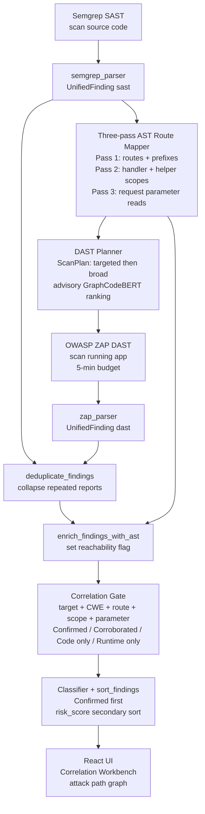

**Three mandatory objectives:**

| Objective | Key Deliverable | Scoring Weight |
|---|---|---|
| 01 — Scan Code & App | `UnifiedFinding` with `cwe_id` covering ≥ 4 CWE types | 30 pts (shared) |
| 02 — Correlate & Merge | Three-pass route mapper + strict correlation gate | 30 pts (shared) |
| 03 — Prioritise | Confirmed first in every view; ≥ 70% noise suppression | 20 pts (shared) |

---

## 2. Container Topology

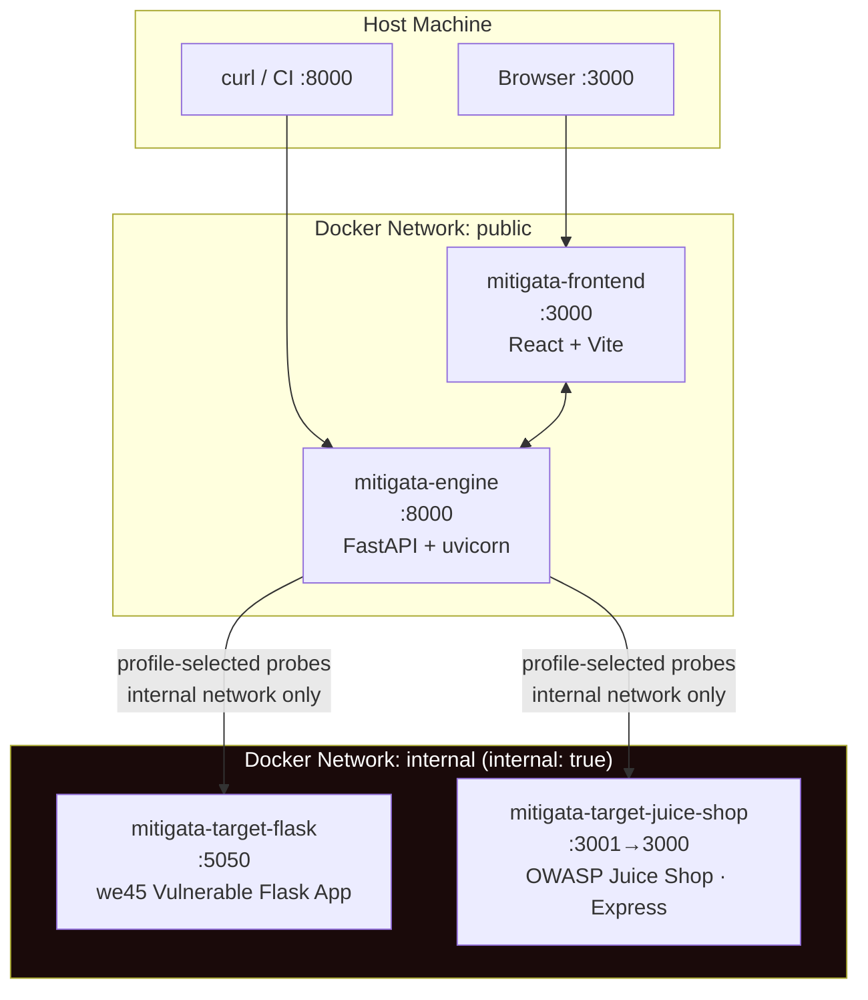

**Volume mounts (engine container):**

```yaml
volumes:
  - ./targets:/targets:ro        # read-only source for both adapters
  - ./configs:/app/configs:ro    # target profiles
  - ./data:/app/data             # raw scan output + verification results
```

---

## 3. Data Flow Diagrams

### 3.1 Main Pipeline — GET /api/graph

```mermaid
sequenceDiagram
    participant B as Browser
    participant FE as Frontend
    participant E as Engine
    participant T as Target (internal)

    B->>FE: GET localhost:3000
    FE->>E: GET /api/graph?target_id=flask_demo

    rect rgb(30, 50, 80)
        Note over E: Step 1 - SAST Ingestion (FR-1, FR-3)
        E->>E: semgrep_parser → sast UnifiedFinding[]
        E->>E: deduplicate SAST by target/CWE/file/line
    end

    rect rgb(30, 60, 50)
        Note over E: Step 2 - Three-Pass AST Route Mapper (FR-4)
        E->>E: Pass 1 - route declarations and prefix mounts
        E->>E: Pass 2 - handler and one-hop helper scopes
        E->>E: Pass 3 - request parameter reads
        E->>E: build_scan_plan - ScanPlan with targeted and broad tasks
        E->>E: GraphCodeBERT ranking if GRAPHCODEBERT_MODE=ON
    end

    rect rgb(60, 30, 50)
        Note over E: Step 3 - DAST (FR-2, FR-3) - runs AFTER SAST and route mapping
        E->>T: ZAP targeted tasks first (15s each)
        T-->>E: alerts JSON
        E->>T: ZAP broad fallback tasks (5s each, if budget remains)
        T-->>E: alerts JSON
        E->>E: zap_parser → dast UnifiedFinding[]
        E->>E: deduplicate DAST by target/CWE/rule/path/method/param
    end

    rect rgb(50, 40, 20)
        Note over E: Step 4 - Correlation and Classification (FR-5, FR-6, FR-7)
        E->>E: enrich_findings_with_ast - set reachable flag
        E->>E: correlate_and_merge - target+CWE+route+scope+parameter
        E->>E: apply persisted verification results
        E->>E: sort_findings - Confirmed first then risk_score
    end

    rect rgb(20, 40, 60)
        Note over E: Step 5 - Graph Build
        E->>E: ELK seed positions - GraphNode[] + GraphEdge[]
        E->>E: GraphStats - total, confirmed, suppression_ratio
        E-->>FE: GraphResponse with nodes, edges, stats
        FE-->>B: Correlation Workbench rendered in under 3s
    end
```

### 3.2 Live Verification Flow — SSE Stream

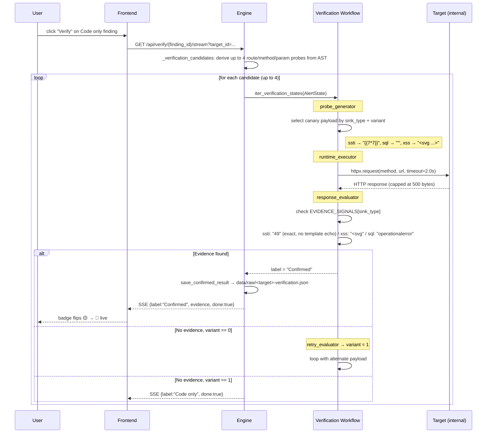

### 3.3 Conditional Retry Flow

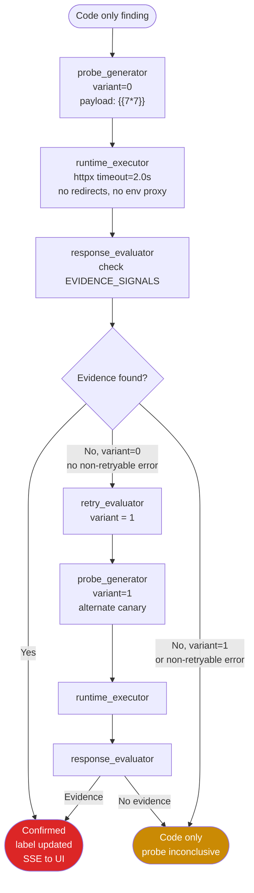

### 3.4 Auto-Remediation Flow

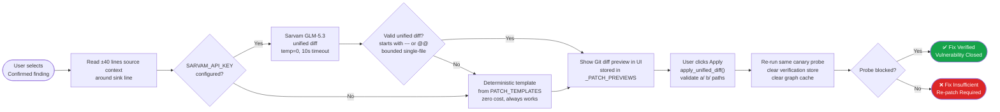

---

## 4. Component Deep-Dives

### 4.1 Ingestion Pipeline — FR-1, FR-2, FR-3

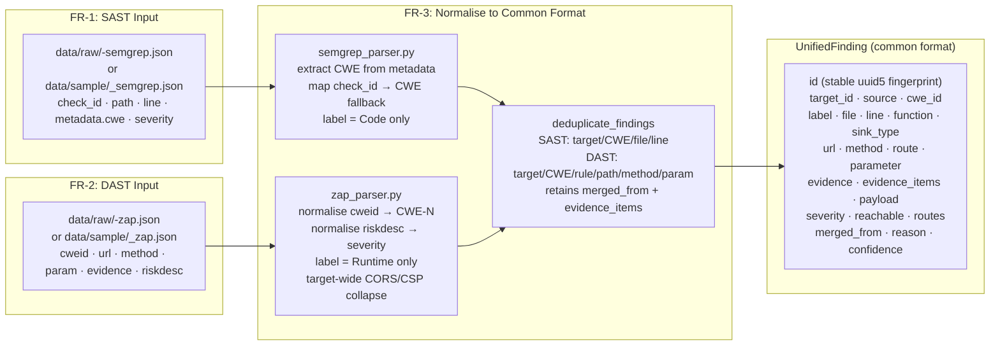

**Stable finding IDs:** `graph.py` derives each finding's ID as `uuid5(NAMESPACE_URL, fingerprint)` from `target_id + source + index + rule_id + cwe_id + file + line + url + method + parameter`. This makes IDs stable across API calls so the UI can safely use them for detail selection and verification.

**Parameterised query suppression (B-2):** `_has_bound_sql_parameters` inspects the Python AST at the reported line. Only a `cursor.execute()` call with a static string query, a recognised bind marker (`?`, `%s`, `:name`, `$N`), and an explicit second argument (tuple/list/dict/name) is suppressed. Unknown or dynamic query construction remains reportable.

### 4.2 Three-Pass AST Route Mapper — FR-4

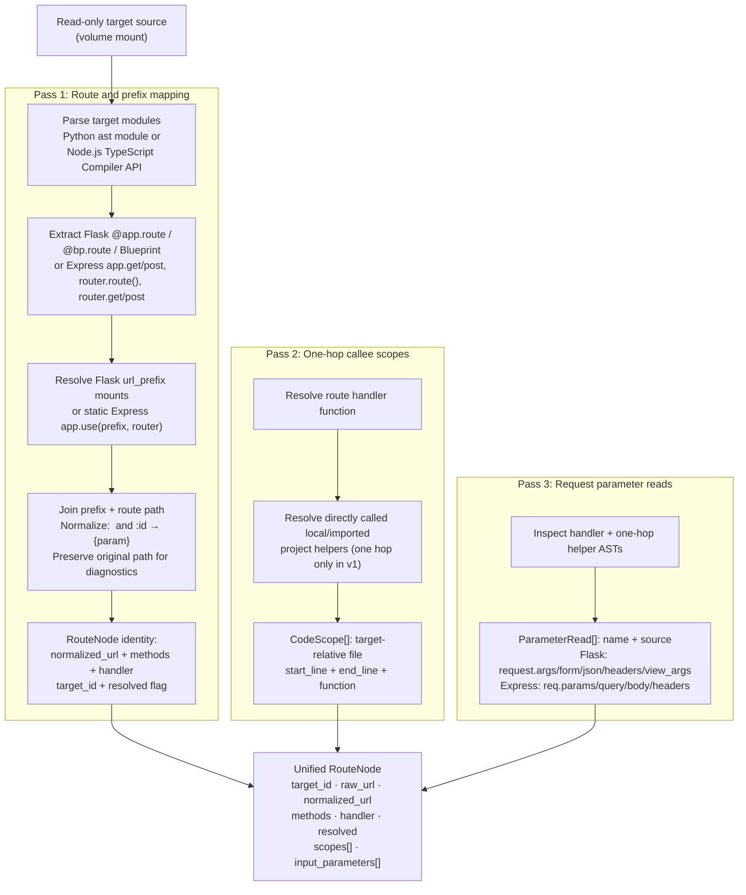

**Key constraints:**
- Pass 2 resolves only **direct** local/imported callees — no transitive chains claimed
- Dynamic/unresolved mount paths remain `resolved=False` and cannot match DAST traffic
- Unresolved request keys (e.g. `request.args.get(some_var)`) are not recorded as `ParameterRead`
- Header parameter names are compared case-insensitively; all other parameter names are case-sensitive

### 4.3 Correlation & Merge Engine — FR-5, FR-6

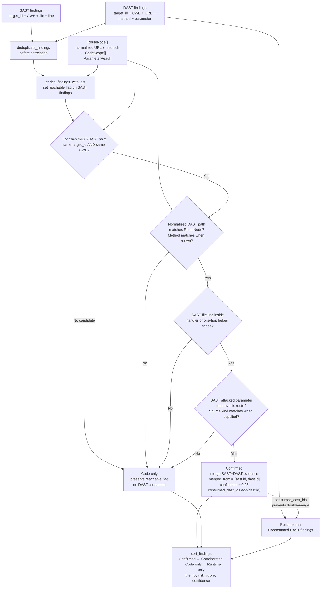

**Corroborated label:** When `target_id`, CWE, route, and source location agree but request-input evidence is incomplete (parameter name missing or source kind absent), the pair is labelled `Corroborated` at confidence 0.7 rather than `Confirmed`. This is a lower-confidence intermediate state between Code only and Confirmed.

**CWE normalisation:** `CWE-079` and `CWE-79` are treated as equal. Different CWE numbers are never treated as equivalent.

### 4.4 DAST Planner — ScanPlan / ScanTask / ScanEvent

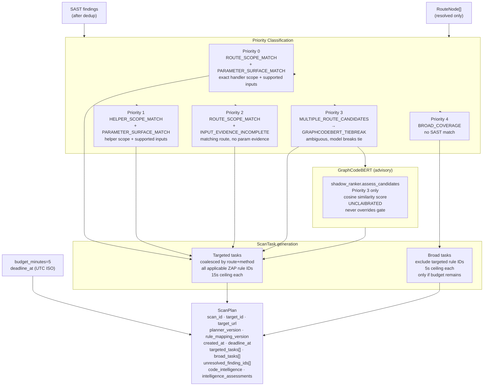

**ZAP rule mapping:**

| CWE | ZAP Rule IDs |
|---|---|
| CWE-22 | 6 |
| CWE-78 | 90020 |
| CWE-79 | 40012, 40014 |
| CWE-89 | 40018 |
| CWE-601 | 20019 |

### 4.5 Runtime Verification Workflow

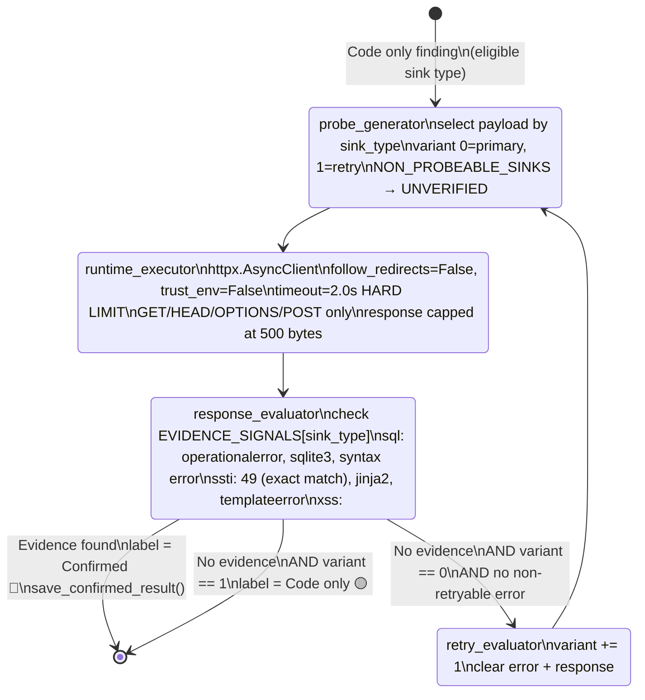

**Non-probeable sinks** (no safe runtime signal): `hardcoded_secret`, `insecure_deserialisation`, `jwt_weak_secret`, `weak_hash`

**Non-retryable errors**: `invalid_target_profile`, `unsafe_http_method`, `invalid_route`, `invalid_parameter`, `invalid_parameter_source`, `unsupported_sink_type`, `path_parameter_not_found`

**Flask 404 handler special case:** The SSTI finding in `pnf(e)` (`@app.errorhandler(404)`) has no route decorator. `_is_flask_not_found_handler` detects it via AST and generates a synthetic probe candidate at `/__mitigata_not_found__/{probe_path}`.

### 4.6 3-Label Classifier — FR-7

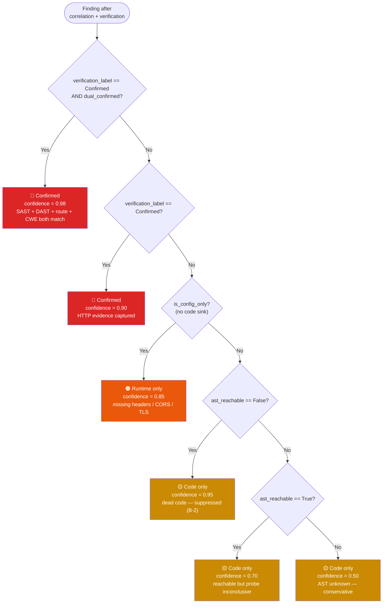

**Risk score (0–100):** `severity_score × 0.7 + exploitability × 0.6` where exploitability accumulates from label (+20 Confirmed, +15 Runtime only, +10 Corroborated), reachability (+10), parameter evidence (+10), and HTTP evidence (+10). Used for secondary sort within each label tier.

### 4.7 Patch Engine — B-4

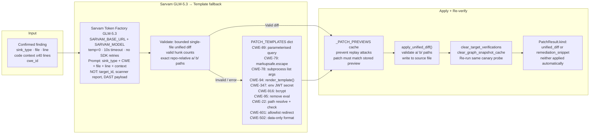

### 4.8 Compliance Translator

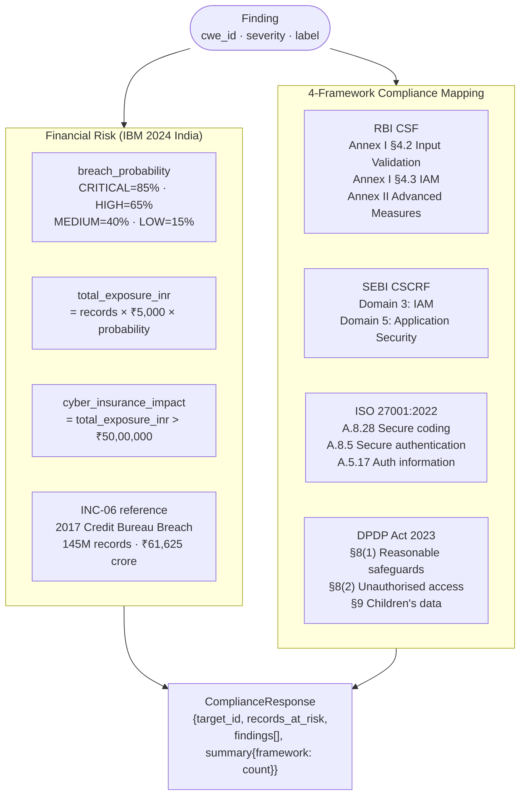

### 4.9 Scan Manager — Job Lifecycle

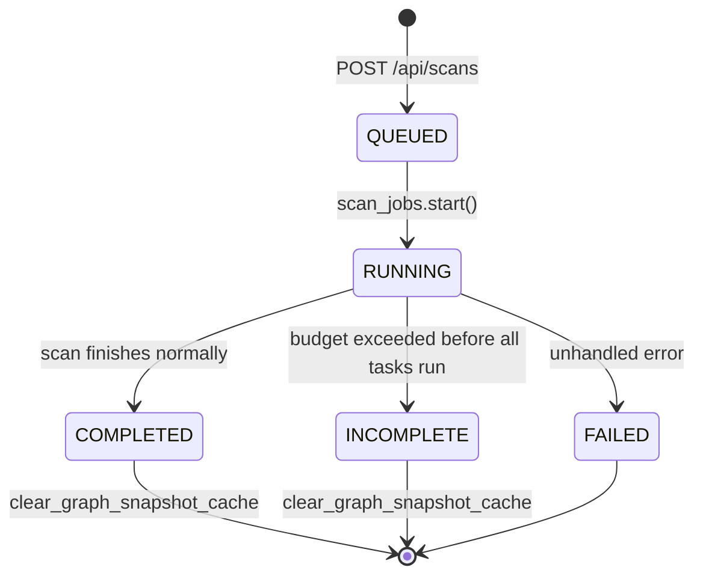

**Scan job constraints:**
- Only one scan may run at a time per instance; `ScanAlreadyRunning` (HTTP 409) if a job is active
- `GET /api/scans/latest?target_id=...` polls job status and clears the graph cache on completion
- `GET /api/scans/compare?target_id=...` diffs the latest vs previous completed scan using target-scoped CWE + location/request-surface identity keys
- Finding history is stored in `data/raw/<target>-finding-history.json` (metadata only, no payloads)

### 4.10 FastAPI Engine Layer — FR-10

```mermaid
graph LR
    subgraph API["FastAPI Engine — http://localhost:8000"]
        G["GET /api/graph\nfull correlation graph\n≤10s · 10s cache TTL"]
        PL["GET /api/planner\nScanPlan preview\ndoes NOT start a scan"]
        SC["POST /api/scans\nstart SAST or DAST job\n202 Accepted"]
        SL["GET /api/scans/latest\njob status + phase counts"]
        SCJ["GET /api/scans/{job_id}\nsingle job status"]
        CMP["GET /api/scans/compare\nnew / fixed / still_open diff"]
        VS["GET /api/verify/{id}/stream\nSSE: probe_history + label flip\n≤2s/probe"]
        P["POST /api/patch\ngenerate unified diff\nSarvam → template fallback"]
        PA["POST /api/patch/apply\napply + re-verify\npreview must match"]
        C["GET /api/compliance\nINR + 4 frameworks\nper finding"]
        SAR["GET /api/export/sarif\nSARIF 2.1\nfail_on_confirmed_high → HTTP 409"]
        TGT["GET /api/targets\n[flask_demo, juice_shop]"]
        H["GET /health\nDocker healthcheck"]
        D["GET /docs\nSwagger UI"]
    end
```

### 4.11 React Frontend — FR-8, FR-9

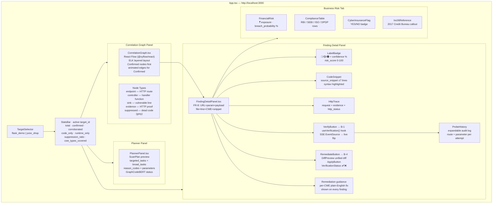

---

## 5. Network Topology

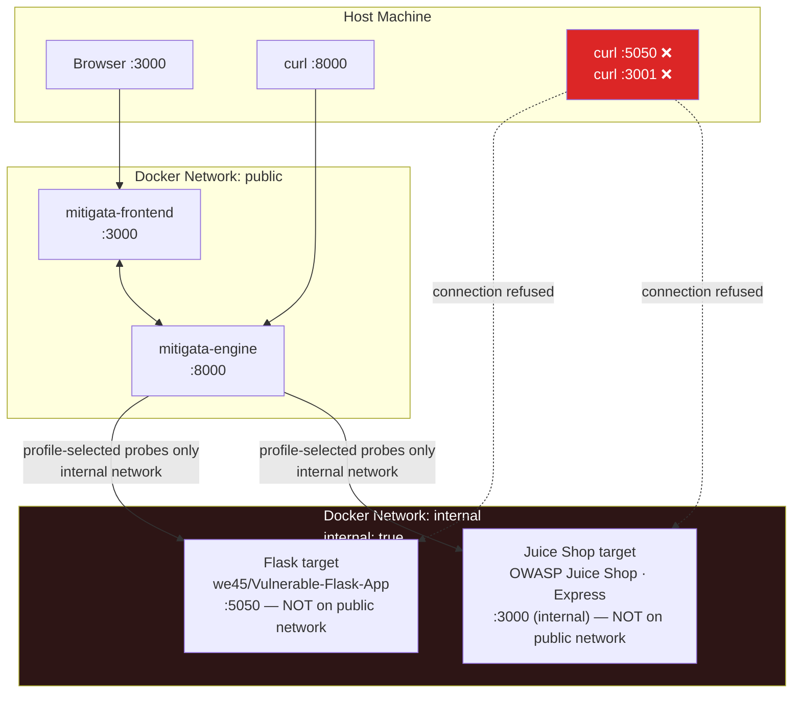

**Probe route:** `engine (internal) → selected target (internal)` — never leaves Docker network. The engine uses only the configured `origin` from `configs/<target_id>.yaml`; finding URLs never supply the request host.

---

## 6. Data Schemas

### 6.1 UnifiedFinding — FR-3 Common Format

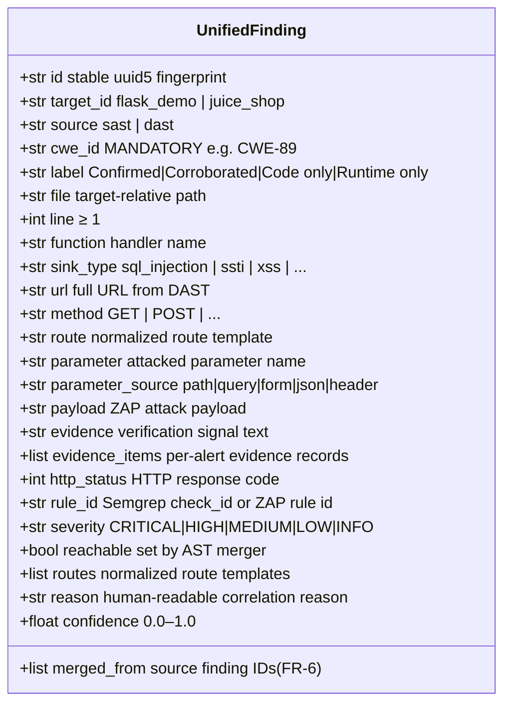

### 6.2 RouteNode — FR-4 Route Mapping

```mermaid
classDiagram
    class RouteNode {
        +str target_id
        +str raw_url  original path from source
        +str normalized_url  {param} placeholders
        +str original_path  pre-normalization
        +list methods  HTTP verbs
        +str handler  module.function
        +bool resolved  False if dynamic mount
        +CodeScope[] scopes
        +ParameterRead[] input_parameters
        +matches_path(path) bool
        +matches_method(method) bool
        +contains_location(file, line) bool
    }

    class CodeScope {
        +str file  target-relative
        +int start_line
        +int end_line
        +str function
    }

    class ParameterRead {
        +str name  parameter name
        +str source  path|query|form|json|header
    }

    RouteNode "1" --> "1..*" CodeScope : handler and direct callees
    RouteNode "1" --> "0..*" ParameterRead : observed request inputs
```

### 6.3 ScanPlan / ScanTask

```mermaid
classDiagram
    class ScanPlan {
        +str scan_id  uuid4
        +str target_id
        +str target_url
        +str planner_version  1.0
        +str rule_mapping_version  1.0
        +str created_at  ISO UTC
        +str deadline_at  ISO UTC
        +ScanTask[] targeted_tasks  sorted by priority_score
        +ScanTask[] broad_tasks  sorted by normalized_url
        +list unresolved_finding_ids  SAST not mapped to any route
        +str status  PLANNED
        +dict code_intelligence  GraphCodeBERT metadata
        +list intelligence_assessments  per-candidate scores
    }

    class ScanTask {
        +str task_id  sha256[:20] of route+method+phase+rules
        +str target_id
        +str route_id
        +str raw_url
        +str normalized_url
        +str method
        +str phase  TARGETED | BROAD
        +int priority_score  0=highest
        +list reason_codes  SAST_CWE_MATCH etc.
        +list finding_ids  linked SAST finding IDs
        +list zap_rule_ids  ZAP scanner IDs
        +list excluded_zap_rule_ids  rules covered by targeted task
        +list parameters  name + source dicts
        +str parameter_limitation  unsupported input types
        +str status  QUEUED|RUNNING|COMPLETED|FAILED
    }

    ScanPlan "1" --> "0..*" ScanTask : targeted_tasks
    ScanPlan "1" --> "0..*" ScanTask : broad_tasks
```

### 6.4 AlertState — Verification Workflow

```mermaid
classDiagram
    class AlertState {
        +str finding_id
        +str target_id
        +str route  normalized route template
        +str method  GET | POST
        +str parameter  attacked parameter name
        +str parameter_source  path|query|form|json|header
        +str sink_type  sql_injection | ssti | ...
        +str probe_payload  canary string
        +int probe_variant  0=primary 1=retry
        +int http_status
        +str http_response  first 500 bytes
        +str http_location  Location header (redirect check)
        +str evidence  signals found in response
        +str label  Confirmed|Code only|UNVERIFIED
        +str error  error code if probe failed
        +list probe_history  ProbeRecord[]
    }

    class ProbeRecord {
        +int variant
        +str payload
        +int status
        +str response_preview  first 200 chars
        +str location  redirect destination
        +str error  if probe failed
    }

    AlertState "1" --> "0..*" ProbeRecord : probe_history
```

### 6.5 GraphResponse — API

```mermaid
classDiagram
    class GraphResponse {
        +str target_id
        +GraphNode[] nodes
        +GraphEdge[] edges
        +GraphStats stats
    }

    class GraphNode {
        +str id
        +str type  endpoint|controller|sink|evidence|suppressed
        +dict position  x, y (ELK seed coordinates)
        +GraphNodeData data
    }

    class GraphNodeData {
        +str label
        +str target_id
        +str finding_id
        +str finding_label
        +float confidence
        +str file
        +int line
        +list routes
        +list mapped_urls  full target URLs
        +str cwe
        +str evidence
        +list evidence_items
        +str payload
        +int risk_score  0-100
        +list merged_from
        +str reason
        +str url
        +str method
        +str parameter
        +str parameter_source
        +int http_status
        +str severity
        +str source
        +str source_snippet  ±7 lines of source
        +str sink_type
        +str function
        +str remediation  per-CWE fix guidance
    }

    class GraphEdge {
        +str id
        +str source
        +str target
        +bool animated  true for Confirmed
    }

    class GraphStats {
        +str target_id
        +int total
        +int confirmed
        +int corroborated
        +int code_only
        +int runtime_only
        +float suppression_ratio  0.0–1.0
        +list cwe_types_covered  Obj 01 proof
    }

    GraphResponse "1" --> "0..*" GraphNode : nodes
    GraphResponse "1" --> "0..*" GraphEdge : edges
    GraphResponse "1" --> "1" GraphStats : stats
    GraphNode "1" --> "1" GraphNodeData : data
```

---

## 7. API Contract

| Endpoint | Method | Description | Performance |
|---|---|---|---|
| `/api/graph` | GET | Full correlation graph for target profile | ≤ 10 s cold, ≤ 1 s cached (10 s TTL) |
| `/api/verify/{id}/stream` | GET | SSE verification stream; probe_history + label | ≤ 2 s per probe |
| `/api/patch` | POST | Generate unified diff (Sarvam → template) | ≤ 10 s |
| `/api/patch/apply` | POST | Apply approved patch + re-verify | ≤ 15 s total |
| `/api/compliance` | GET | INR exposure + 4 regulatory frameworks | < 200 ms |
| `/api/export/sarif` | GET | SARIF 2.1; `fail_on_confirmed_high=true` → HTTP 409 | < 1 s |
| `/api/planner` | GET | ScanPlan preview (no scan started) | ≤ 5 s |
| `/api/scans` | POST | Start SAST or DAST scan job | 202 Accepted |
| `/api/scans/latest` | GET | Latest job status + phase counts | < 100 ms |
| `/api/scans/{job_id}` | GET | Single job status | < 100 ms |
| `/api/scans/compare` | GET | new / fixed / still_open diff | < 200 ms |
| `/api/targets` | GET | `["flask_demo", "juice_shop"]` | < 10 ms |
| `/health` | GET | Docker healthcheck | < 10 ms |
| `/docs` | GET | Swagger UI | — |

**SSE event format:**

```json
// Intermediate update:
{"finding_id": "...", "target_id": "flask_demo", "label": "Code only", "probe_history": [...], "done": false}

// Final confirmed:
{"finding_id": "...", "target_id": "flask_demo", "label": "Confirmed", "evidence": "Response contained verification signals: 49", "probe_history": [...], "done": true}

// Error:
event: verification-error
{"finding_id": "...", "target_id": "flask_demo", "done": true, "error": "No safe probe is available for this sink..."}
```

---

## 8. Performance Budget

| Operation | Budget | Implementation |
|---|---|---|
| `docker compose up --build` | < 60 s | cached layers after first build |
| Target healthcheck | < 30 s | curl retry 3× with 10 s gap |
| `GET /api/graph` (cold) | **≤ 10 s** | AST parse + ELK seed layout |
| `GET /api/graph` (warm) | < 1 s | in-memory 10 s TTL cache |
| Single verification probe | **≤ 2 s** | `asyncio.timeout(2.0)` + `httpx.Timeout(2.0)` |
| Probe + retry | ≤ 4 s | 2 × 2 s probes |
| UI initial render | **≤ 3 s** | pre-computed ELK seed positions |
| Patch generation (Sarvam) | ≤ 10 s | 10 s timeout, no SDK retries |
| Patch generation (template) | < 50 ms | dict lookup |
| Patch apply + re-verify | **≤ 15 s** | within PRD budget |
| ZAP DAST window | **≤ 5 min** | targeted 15 s / broad 5 s per task |

---

## 9. Dependency Graph

```mermaid
graph TD
    subgraph ENGINE["engine/"]
        MAIN["api/main.py\nFastAPI app"]
        GRAPH["api/graph.py\nGraphSnapshot builder\n10s TTL cache"]

        subgraph ING["ingestion/"]
            SCHEMA["schema.py\nUnifiedFinding · Pydantic v2"]
            SP["semgrep_parser.py"]
            ZP["zap_parser.py"]
            CORR["correlator.py\ncorrelate_and_merge\nFR-5 FR-6"]
            DEDUP["deduplication.py\ndeduplicate_findings"]
            INC["incremental.py\nincremental DAST ingestion"]
        end

        subgraph AST["ast_mapper/ + adapters/"]
            RS["route_schema.py\nRouteNode · CodeScope · ParameterRead"]
            ADAPT["adapters/\nflask_adapter.py · express_adapter.py\nbase.py RouteAdapter Protocol"]
            SD["sink_detector.py"]
            CG["call_graph.py\nbuild_call_graph\ndispatch Flask or Express"]
            MG["merger.py\nenrich_findings_with_ast"]
        end

        subgraph VER["verification/"]
            ST["state.py\nAlertState TypedDict · ProbeRecord"]
            ND["nodes.py\nprobe_generator · runtime_executor\nresponse_evaluator · retry_evaluator\nbuild_local_probe_url"]
            WF["workflow.py\niter_verification_states (async)"]
            PROF["profile.py\nload_target_profile"]
            VSTORE["verification_store.py\nsave/load/clear confirmed results"]
        end

        CLF["classifier/classifier.py\nclassify · apply_classification\nsort_findings · calculate_issue_risk_score"]

        subgraph CI["code_intelligence/"]
            SR["shadow_ranker.py\nGraphCodeBERTShadowRanker\nroute_candidate_id"]
            AS["assessment_schema.py"]
        end

        subgraph PLAN["dast_planner/"]
            PL["planner.py\nbuild_scan_plan\nScanPlan · ScanTask"]
        end

        subgraph SM["scan_manager/"]
            JOBS["jobs.py\nscan_jobs · ScanAlreadyRunning"]
            HIST["history.py\ncompare_finding_snapshots"]
            COORD["coordinator.py\nbuild_scan_state · apply_task_update"]
            EVT["event_store.py"]
            STATE["state.py\nScanState"]
        end

        subgraph PCH["patch_engine/"]
            LP["llm_patcher.py\ngenerate_patch · apply_unified_diff\nPatchResult · PatchGenerationError"]
            TP["templates.py\nPATCH_TEMPLATES"]
        end

        subgraph CMP["compliance/"]
            RC["risk_calculator.py\ncalculate_inr_exposure"]
            CM["mapping.py\nmap_finding_to_frameworks\nFRAMEWORK_ORDER"]
        end
    end

    MAIN --> GRAPH & PL & SM & VER & PCH & CMP
    GRAPH --> SP & ZP & CORR & DEDUP & CG & MG & CLF & VSTORE & PROF
    SP & ZP & CORR & DEDUP & MG --> SCHEMA
    CG --> ADAPT & SD & RS
    ADAPT --> RS
    WF --> ST & ND
    ND --> PROF
    PL --> SR & RS
    SR --> AS
    JOBS --> COORD & EVT & STATE
    CM --> RC

    subgraph FRONTEND["frontend/src/"]
        APP["App.tsx"]
        CGRAPH["CorrelationGraph.tsx\n@xyflow/react · elkjs"]
        FDP["FindingDetailPanel.tsx"]
        BRP["BusinessRiskPanel.tsx"]
        PP["PlannerPanel.tsx"]
        HOOK["hooks/useVerification.ts\nSSE EventSource"]
    end

    APP --> CGRAPH & FDP & BRP & PP
    FDP --> HOOK
```

---

*Architecture version: 2.0 — Mitigata Hackathon Problem 06 (Flagship)*
*All diagrams use Mermaid — renders natively in GitHub, GitLab, VS Code (Markdown Preview Enhanced), and Obsidian*
*References: [P06-PRD.md](P06-PRD.md) · [P06-SAST-DAST-Correlation-Engine.md](P06-SAST-DAST-Correlation-Engine.md) · [P06-Build-Plan.md](P06-Build-Plan.md)*
