# P06 Architecture — Mitigata SAST/DAST Correlation Engine

> **Status:** Current — reflects the implemented repo state as of the latest commit.
> **Version:** 2.0 — route-aware DAST planner, advisory GraphCodeBERT ranking, bounded verification workflow, scan manager, deduplication, incremental correlation, SARIF export, scan comparison
> **References:** [P06-PRD.md](P06-PRD.md) · [P06-SAST-DAST-Correlation-Engine.md](P06-SAST-DAST-Correlation-Engine.md) · [P06-Build-Plan.md](P06-Build-Plan.md)

---

## Table of Contents

1. [System Overview](#1-system-overview)
2. [Container Topology](#2-container-topology)
3. [Data Flow Diagrams](#3-data-flow-diagrams)
4. [Component Deep-Dives](#4-component-deep-dives)
5. [Network Topology](#5-network-topology)
6. [Data Schemas](#6-data-schemas)
7. [API Contract](#7-api-contract)
8. [Performance Budget](#8-performance-budget)
9. [Dependency Graph](#9-dependency-graph)

---

## 1. System Overview

```
┌──────────────────────────────────────────────────────────────────────────────┐
│                         Mitigata Pipeline                                    │
│                                                                              │
│  Semgrep (SAST)  ──►  UnifiedFinding[]  ──►  Three-pass AST Route Mapper    │
│  OWASP ZAP (DAST)──►  UnifiedFinding[]  ──►  Deduplication                  │
│                                         ──►  Correlation Gate                │
│                                               (target + CWE + route +        │
│                                                scope + parameter)            │
│                                         ──►  Classifier                      │
│                                               Confirmed / Code only /        │
│                                               Runtime only                   │
│                                         ──►  React UI (Correlation           │
│                                               Workbench)                     │
└──────────────────────────────────────────────────────────────────────────────┘
```

**Three mandatory objectives:**

| Objective | Key Deliverable | Scoring Weight |
|---|---|---|
| 01 — Scan Code & App | `UnifiedFinding` with `cwe_id` covering ≥ 4 CWE types | 30 pts (shared) |
| 02 — Correlate & Merge | Three-pass route mapper + strict correlation gate | 30 pts (shared) |
| 03 — Prioritise | Confirmed first in every view; ≥ 70% noise suppression | 20 pts (shared) |

---

## 2. Container Topology

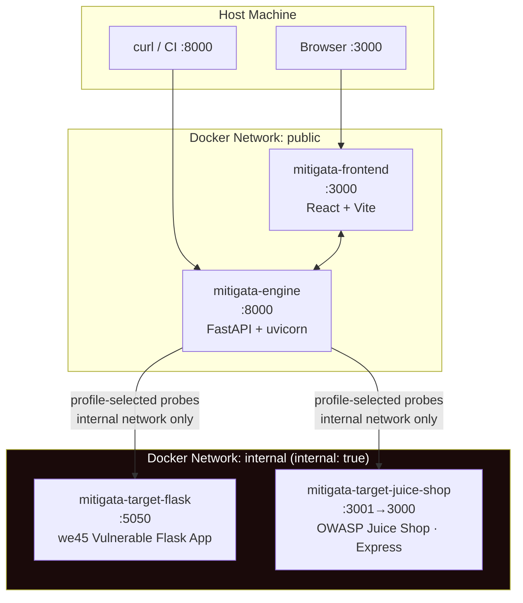

**Volume mounts (engine container):**

```yaml
volumes:
  - ./targets:/targets:ro        # read-only source for both adapters
  - ./configs:/app/configs:ro    # target profiles
  - ./data:/app/data             # raw scan output + verification results
```

---

## 3. Data Flow Diagrams

### 3.1 Main Pipeline — GET /api/graph

```mermaid
sequenceDiagram
    participant B as Browser
    participant FE as Frontend :3000
    participant E as Engine :8000
    participant DC as Docker (internal)

    B->>FE: GET http://localhost:3000
    FE->>E: GET /api/graph?target_id=flask_demo|juice_shop

    Note over E: Ingestion (FR-1, FR-2, FR-3)
    E->>E: semgrep_parser → UnifiedFinding[] (sast, label=Code only)
    E->>E: zap_parser → UnifiedFinding[] (dast, label=Runtime only)
    E->>E: deduplicate_findings (SAST by target/CWE/location; DAST by target/CWE/rule/surface)

    Note over E: Three-Pass AST Route Mapper (FR-4)
    E->>E: select Flask or Express adapter by target profile
    E->>E: Pass 1: decorators/mounts → normalized RouteNode[]
    E->>E: Pass 2: handler + one-hop helper scopes → CodeScope[]
    E->>E: Pass 3: request parameter reads → ParameterRead[]

    Note over E: DAST Planning
    E->>E: build_scan_plan → ScanPlan (targeted + broad ScanTask queue)
    E->>E: advisory GraphCodeBERT ranking (GRAPHCODEBERT_MODE=ON only)

    Note over E: Correlation (FR-5, FR-6)
    E->>E: enrich_findings_with_ast (reachability)
    E->>E: correlate_and_merge: target+CWE+route+scope+parameter → Confirmed
    E->>E: apply persisted verification results
    E->>E: sort_findings: Confirmed → Corroborated → Code only → Runtime only

    Note over E: Graph Build
    E->>E: ELK seed positions → GraphNode[] + GraphEdge[]
    E->>E: GraphStats: total, confirmed, code_only, runtime_only, suppression_ratio
    E-->>FE: GraphResponse {nodes, edges, stats}
    FE-->>B: Correlation Workbench rendered ≤ 3 s
```

### 3.2 Live Verification Flow — SSE Stream

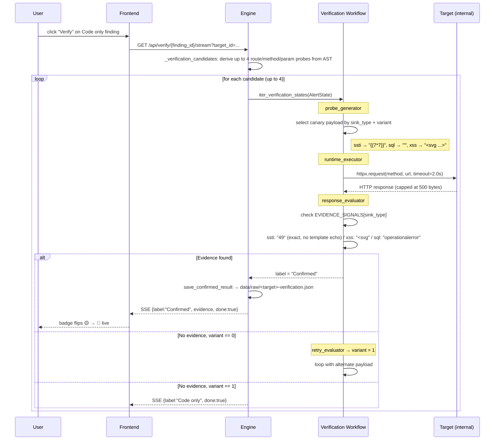

### 3.3 Conditional Retry Flow

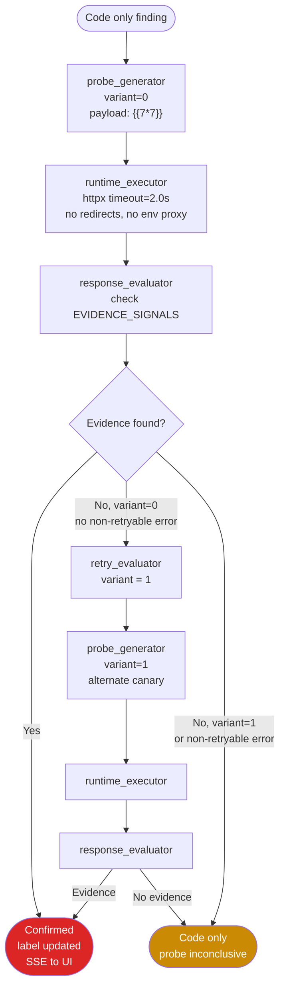

### 3.4 Auto-Remediation Flow

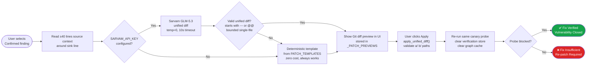

---

## 4. Component Deep-Dives

### 4.1 Ingestion Pipeline — FR-1, FR-2, FR-3

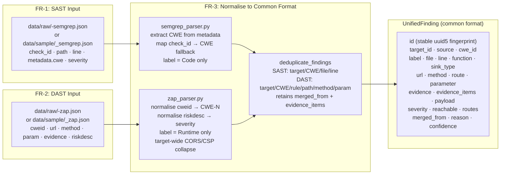

**Stable finding IDs:** `graph.py` derives each finding's ID as `uuid5(NAMESPACE_URL, fingerprint)` from `target_id + source + index + rule_id + cwe_id + file + line + url + method + parameter`. This makes IDs stable across API calls so the UI can safely use them for detail selection and verification.

**Parameterised query suppression (B-2):** `_has_bound_sql_parameters` inspects the Python AST at the reported line. Only a `cursor.execute()` call with a static string query, a recognised bind marker (`?`, `%s`, `:name`, `$N`), and an explicit second argument (tuple/list/dict/name) is suppressed. Unknown or dynamic query construction remains reportable.

### 4.2 Three-Pass AST Route Mapper — FR-4

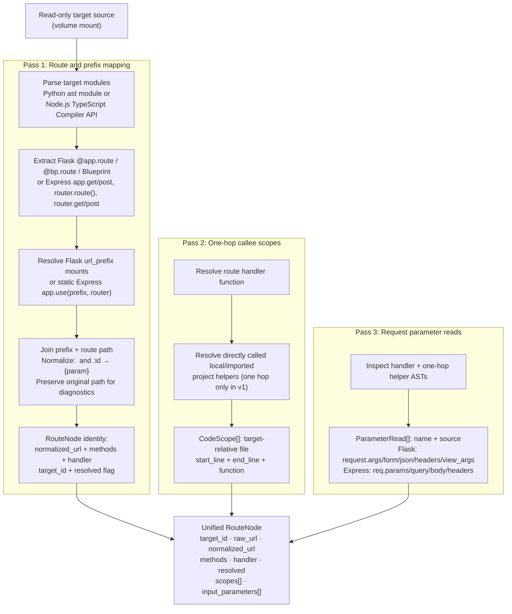

**Key constraints:**
- Pass 2 resolves only **direct** local/imported callees — no transitive chains claimed
- Dynamic/unresolved mount paths remain `resolved=False` and cannot match DAST traffic
- Unresolved request keys (e.g. `request.args.get(some_var)`) are not recorded as `ParameterRead`
- Header parameter names are compared case-insensitively; all other parameter names are case-sensitive

### 4.3 Correlation & Merge Engine — FR-5, FR-6

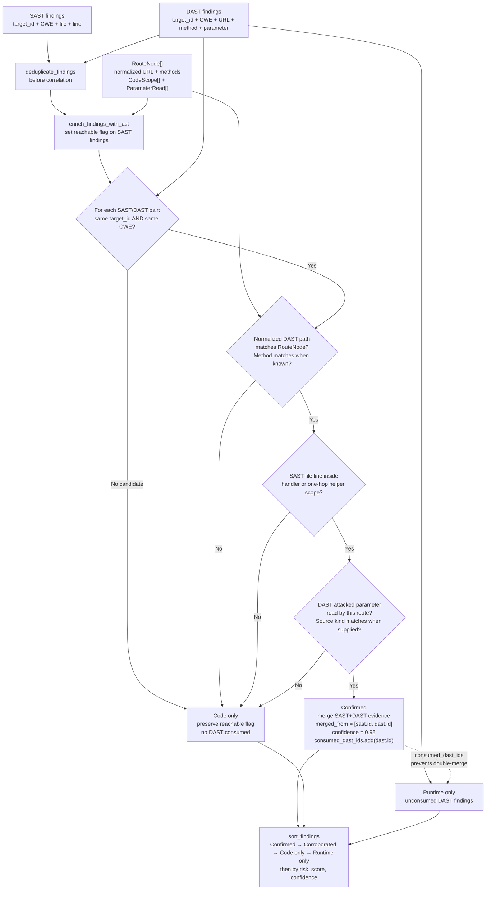

**Corroborated label:** When `target_id`, CWE, route, and source location agree but request-input evidence is incomplete (parameter name missing or source kind absent), the pair is labelled `Corroborated` at confidence 0.7 rather than `Confirmed`. This is a lower-confidence intermediate state between Code only and Confirmed.

**CWE normalisation:** `CWE-079` and `CWE-79` are treated as equal. Different CWE numbers are never treated as equivalent.

### 4.4 DAST Planner — ScanPlan / ScanTask / ScanEvent

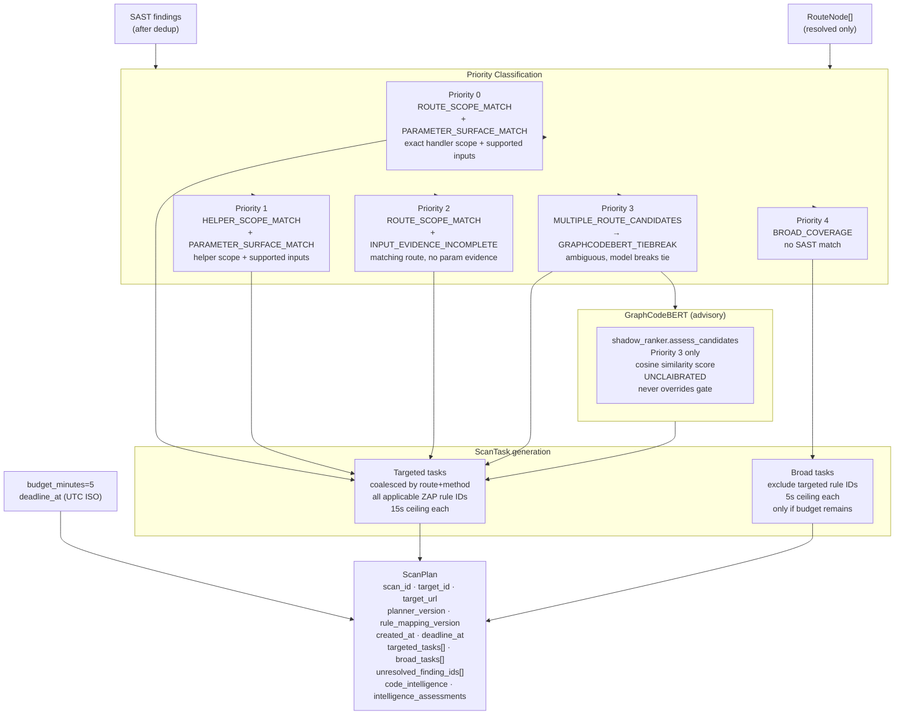

**ZAP rule mapping:**

| CWE | ZAP Rule IDs |
|---|---|
| CWE-22 | 6 |
| CWE-78 | 90020 |
| CWE-79 | 40012, 40014 |
| CWE-89 | 40018 |
| CWE-601 | 20019 |

### 4.5 Runtime Verification Workflow

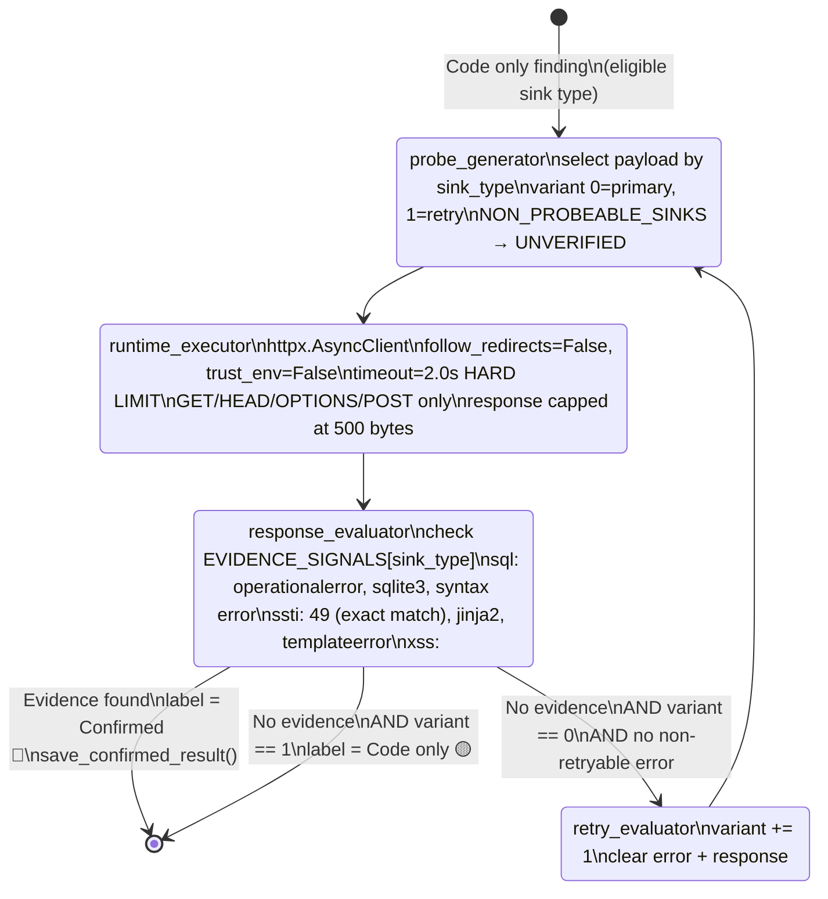

**Non-probeable sinks** (no safe runtime signal): `hardcoded_secret`, `insecure_deserialisation`, `jwt_weak_secret`, `weak_hash`

**Non-retryable errors**: `invalid_target_profile`, `unsafe_http_method`, `invalid_route`, `invalid_parameter`, `invalid_parameter_source`, `unsupported_sink_type`, `path_parameter_not_found`

**Flask 404 handler special case:** The SSTI finding in `pnf(e)` (`@app.errorhandler(404)`) has no route decorator. `_is_flask_not_found_handler` detects it via AST and generates a synthetic probe candidate at `/__mitigata_not_found__/{probe_path}`.

### 4.6 3-Label Classifier — FR-7

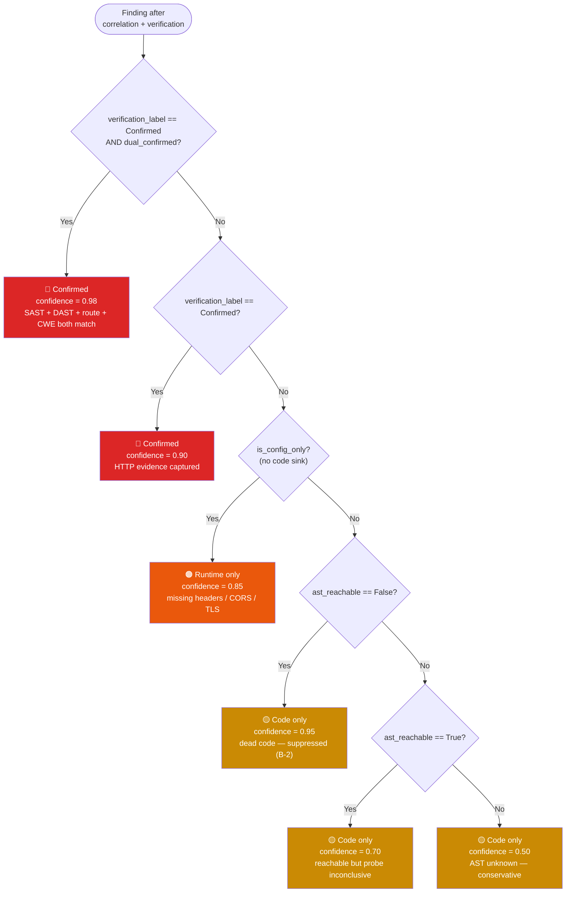

**Risk score (0–100):** `severity_score × 0.7 + exploitability × 0.6` where exploitability accumulates from label (+20 Confirmed, +15 Runtime only, +10 Corroborated), reachability (+10), parameter evidence (+10), and HTTP evidence (+10). Used for secondary sort within each label tier.

### 4.7 Patch Engine — B-4

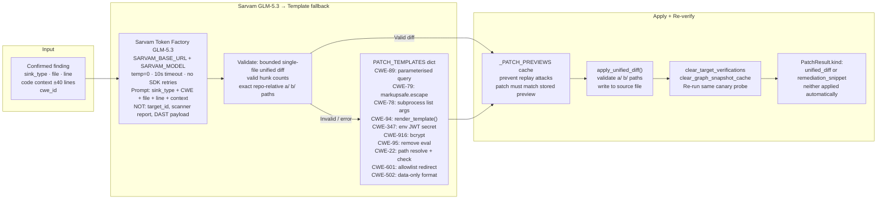

### 4.8 Compliance Translator

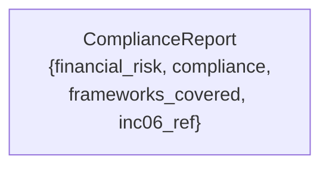

### 4.8 FastAPI Engine Layer — FR-10

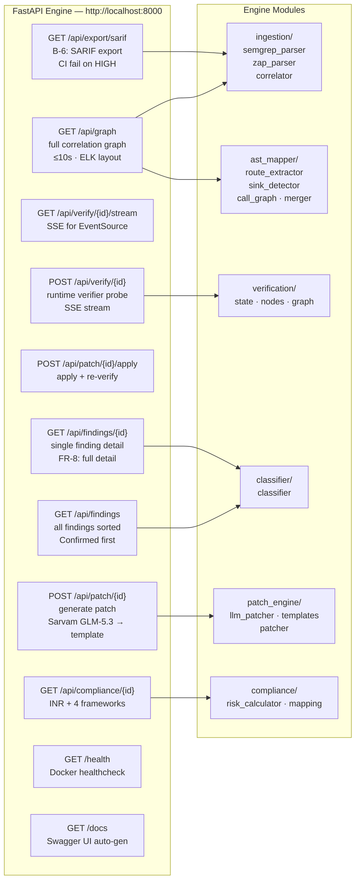

### 4.9 React Frontend — FR-8, FR-9

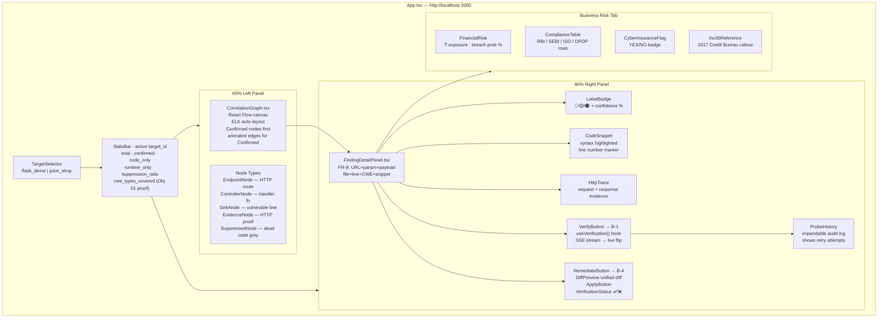

---

## 5. Network Topology

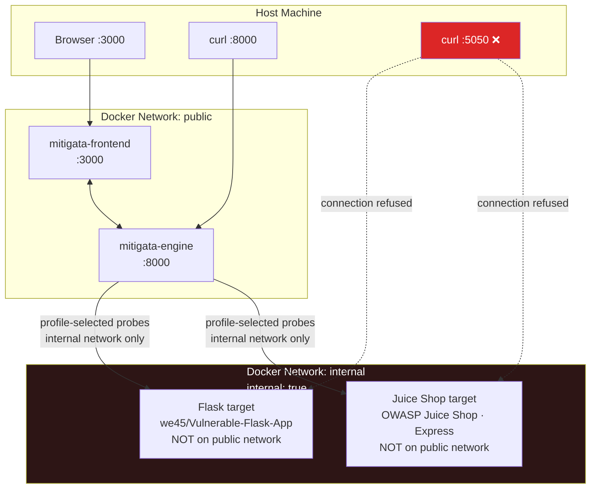

**Probe route:** `engine (internal) → selected target (internal)` — never leaves Docker network. Target profile selection determines both the target origin and the matching read-only source mount; the engine must not fall back to an arbitrary host or combine results across profiles.

---

## 6. Data Schemas

### 6.1 UnifiedFinding — FR-3 Common Format

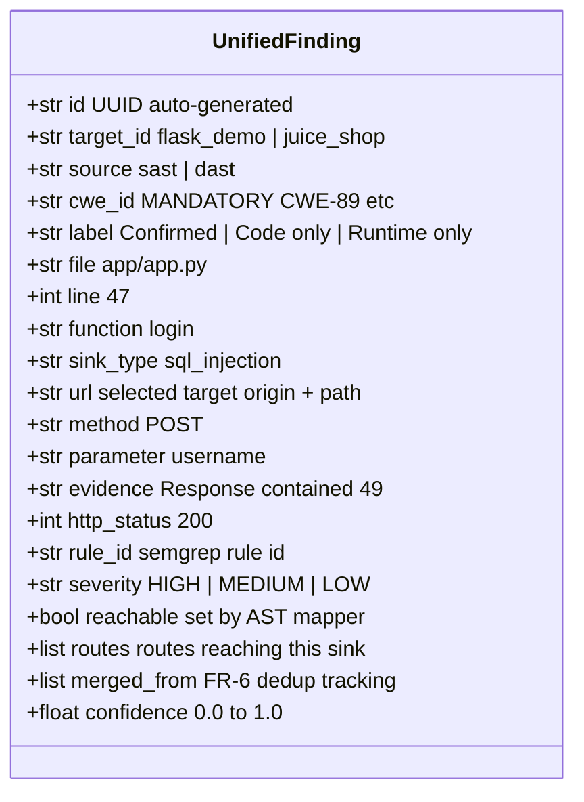

### 6.2 RouteNode — FR-4 Route Mapping

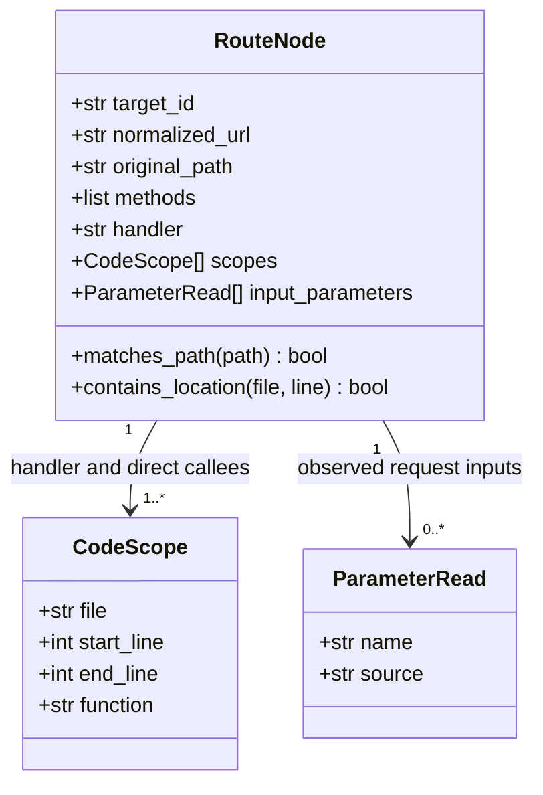

### 6.3 AlertState — runtime verifier

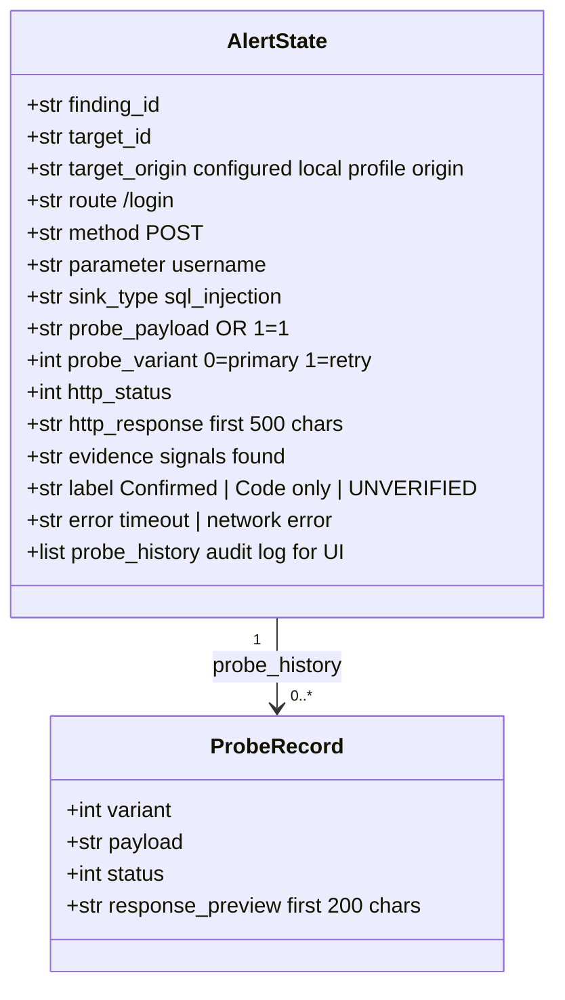

### 6.4 GraphResponse — API

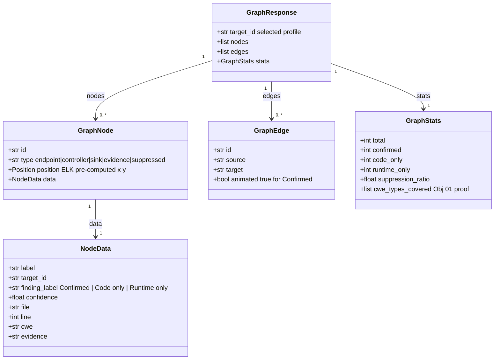

---

## 7. API Contract

```mermaid
graph LR
    subgraph ENDPOINTS["FastAPI Endpoints"]
        E1["GET /api/graph?target_id=...\nprofile-scoped · ≤10s · cached 10s TTL"]
        E2["POST /api/verify/{id}\nfinding target_id selects profile\nSSE stream · ≤2s/probe"]
        E3["GET /api/verify/{id}/stream\nEventSource endpoint"]
        E4["POST /api/patch/{id}\nselected-target source · ≤15s"]
        E5["POST /api/patch/{id}/apply\nprofile-scoped git apply + re-verify"]
        E6["GET /api/compliance/{id}\n<200ms · dict lookup"]
        E7["GET /api/findings?target_id=...\nprofile-scoped · Confirmed first"]
        E8["GET /api/findings/{id}\nFR-8 detail includes target_id"]
        E9["GET /api/export/sarif\nB-6 SARIF export"]
        E10["GET /health\nDocker healthcheck"]
        E11["GET /docs\nSwagger UI"]
    end
```

**SSE Event Format:**
```json
// Intermediate:
{"label": "Code only", "probe_history": [...], "done": false}
// Final:
{"label": "Confirmed", "evidence": "['49']", "probe_history": [...], "done": true}
```

---

## 8. Answer Key Mapping

How our architecture maps to the 36 planted vulnerabilities judges score against:

```mermaid
graph TD
    subgraph AK["Flask fixture answer key (36 planted)"]
        P20["20 Code+Runtime Pairs\nConfirmed candidates"]
        P10["10 Code only\ne.g. hardcoded secrets"]
        P6["6 Runtime only\ne.g. missing headers"]
        P8["~8 Safe Decoys\nparameterised queries\nshould NOT be reported"]
    end

    subgraph HOW["How We Hit Each"]
        H20["target_id + CWE + normalized route\n+ method/source when known\n+ code scope + attacked parameter\n→ Confirmed label"]
        H10["SAST only, no DAST match\n→ Code only label\nFR-7 classification"]
        H6["DAST only, no SAST match\n→ Runtime only label\nFR-7 classification"]
        H8["AST reachability check\nparameterised query detection\nB-2 noise cut\nNOT reported"]
    end

    subgraph TARGETS["Performance Targets"]
        T1["Correct links > 50% Good\n> 80% Great\nreport metrics per target profile"]
        T2["Wrong links < 20% Good\n< 5% Great\nAST gates false merges"]
        T3["False alarms < 30% Good\n< 10% Great\nB-2 suppresses safe decoys"]
        T4["Code detection > 60% Good\n> 85% Great\nSemgrep multi-config"]
        T5["Runtime detection > 50% Good\n> 80% Great\nZAP all 30 routes"]
    end

    P20 --> H20 --> T1
    P10 --> H10 --> T2
    P6 --> H6 --> T3
    P8 --> H8 --> T3
    H20 --> T4
    H20 --> T5
```

---

## 9. Performance Budget

```mermaid
gantt
    title Operation Timing Budget
    dateFormat  X
    axisFormat  %ss

    section Startup
    docker compose up --build    :0, 60
    Target healthcheck           :0, 30

    section API (cold)
    GET /api/graph (cold)        :crit, 0, 10
    GET /api/graph (warm/cached) :0, 1

    section runtime verifier Probes
    Single probe (hard limit)    :crit, 0, 2
    Probe + retry (2 attempts)   :0, 4

    section UI
    Initial render               :crit, 0, 3
    Node click → detail          :0, 1

    section Patch
    GLM-5.3 patch generation    :0, 10
    Template patch (fallback)    :0, 1
    git apply + re-verify        :0, 3
    Total patch + re-verify      :crit, 0, 15

    section Compliance
    Compliance report            :0, 1
```

| Operation | Budget | Implementation |
|---|---|---|
| `docker compose up --build` | < 60s | cached layers after first run |
| Target healthcheck | < 30s | curl retry 3× with 10s gap |
| `GET /api/graph` (cold) | **≤ 10s** | AST parse + ELK layout |
| `GET /api/graph` (warm) | < 1s | in-memory cache |
| Single runtime verifier probe | **≤ 2s** | `httpx timeout=2.0` |
| Probe + retry | ≤ 4s | 2 × 2s probes |
| UI initial render | **≤ 3s** | pre-computed ELK positions |
| Patch generation (GLM-5.3) | ≤ 10s | 10s timeout on LLM |
| Patch generation (template) | < 50ms | dict lookup |
| Total patch + re-verify | **≤ 15s** | within PRD budget |
| Full scan + report | **< 5 min** | pre-seeded data + targeted probes |

---

## 10. Dependency Graph

```mermaid
graph TD
    subgraph ENGINE["engine/"]
        MAIN["api/main.py\nFastAPI app"]

        subgraph ING["ingestion/"]
            SCHEMA["schema.py\nUnifiedFinding\nPydantic v2"]
            SP["semgrep_parser.py"]
            ZP["zap_parser.py"]
            CORR["correlator.py\ntarget + CWE + route + scope + parameter\nFR-5 FR-6"]
        end

        subgraph AST["ast_mapper/ + adapters/"]
            RS["route_schema.py\nRouteNode · CodeScope · ParameterRead"]
            RE["Flask + Express adapters\nFR-4\nPython ast + Node.js AST"]
            SD["sink_detector.py\nstdlib: ast"]
            CG["call_graph.py\none-hop helper scopes\nrequest parameter reads"]
            MG["merger.py\nAST enrichment"]
        end

        subgraph LGM["verification/"]
            ST["state.py\nAlertState TypedDict"]
            ND["nodes.py\nhttpx, os"]
            GR["workflow.py\nplain async sequence"]
        end

        CLF["classifier/classifier.py\nstdlib only"]

        subgraph PCH["patch_engine/"]
            LP["llm_patcher.py\nopenai, os"]
            TP["templates.py\nstdlib only"]
            PA["patcher.py\nsubprocess, git"]
        end

        subgraph CMP["compliance/"]
            RC["risk_calculator.py\nstdlib only"]
            CM["mapping.py\nstdlib only"]
        end
    end

    MAIN --> SP & ZP & CORR
    MAIN --> CG & MG
    MAIN --> GR
    MAIN --> CLF
    MAIN --> PA
    MAIN --> CM

    SP --> SCHEMA
    ZP --> SCHEMA
    CORR --> SCHEMA
    MG --> SCHEMA
    CG --> RE & SD & RS
    RE --> RS
    GR --> ST & ND
    PA --> LP & TP
    CM --> RC

    subgraph FRONTEND["frontend/src/"]
        APP["App.tsx"]
        CGRAPH["CorrelationGraph.tsx\n@xyflow/react · elkjs"]
        FDP["FindingDetailPanel.tsx"]
        BRP["BusinessRiskPanel.tsx"]
        RTB["ReTestButton.tsx"]
        HOOKS["hooks/\nuseVerification SSE\nusePatch"]
    end

    APP --> CGRAPH & FDP & BRP & RTB
    FDP --> HOOKS
    RTB --> HOOKS

    subgraph DEPS["Python deps"]
        FASTAPI["fastapi · uvicorn"]
        PYDANTIC["pydantic>=2"]
        HTTPX["httpx"]
        PY_DEP["plain Python"]
        OAI["openai (optional)"]
    end

    MAIN --- FASTAPI
    SCHEMA --- PYDANTIC
    ND --- HTTPX
    GR --- PY_DEP
    LP --- OAI
```

**Objective-to-Component Mapping:**

```mermaid
graph LR
    subgraph OBJ["Objectives → Components"]
        O1["Objective 01\nFR-1 FR-2 FR-3"] --> C1["semgrep_parser\nzap_parser\nschema UnifiedFinding"]
        O2["Objective 02\nFR-4 FR-5 FR-6"] --> C2["three-pass Flask/Express route adapters FR-4\nroute-aware DAST planner + GraphCodeBERT ranking\ncorrelator: target + CWE + route + scope + parameter\nmethod/source when available · FR-5 FR-6 dedup"]
        O3["Objective 03\nFR-7 FR-8 FR-9"] --> C3["classifier\nverification B-1\nFindingDetailPanel FR-8\ncorrelator sort FR-9"]
    end
```

---

*Architecture version: 1.5 — Mitigata Hackathon Problem 06 (Flagship); route-aware planner with advisory GraphCodeBERT ranking, bounded verification, and time-budgeted DAST*
*All diagrams use Mermaid — renders natively in GitHub, GitLab, VS Code with Markdown Preview Enhanced, and Obsidian*  
*Reference: [P06-PRD.md](P06-PRD.md) · [P06-SAST-DAST-Correlation-Engine.md](P06-SAST-DAST-Correlation-Engine.md) · [P06-Build-Plan.md](P06-Build-Plan.md)*
