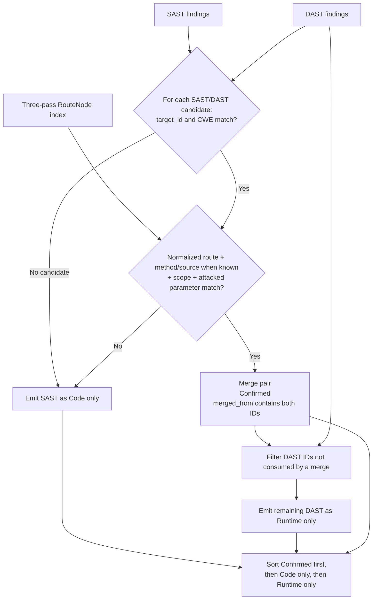
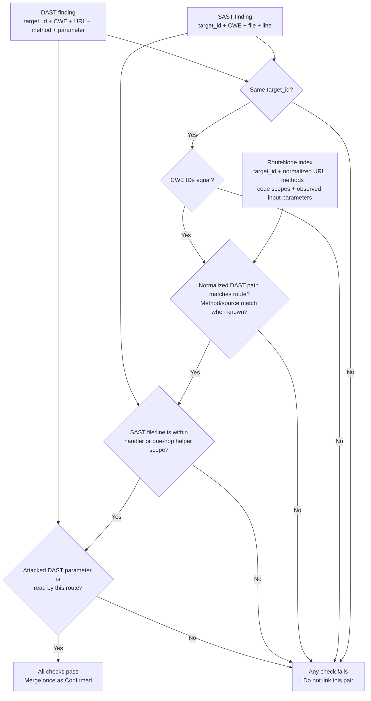
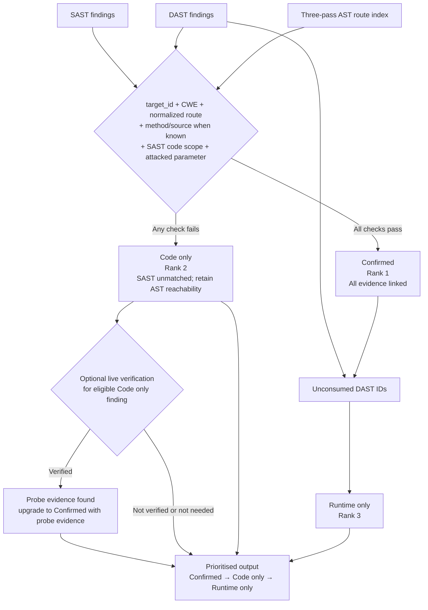

# Problem 06 (Flagship): SAST & DAST Correlation Engine
## Scan Code + Runtime · Correlate · Prioritise

> **Status:** Current — aligned with the implemented repo state, `engine/README.md`, and `engine/api/`.
> **Mitigata Hackathon — Problem 06 · FLAGSHIP**
> Category: Application Security · AI/ML · Compliance Engineering
> Bonus Tier: **Flagship Challenge** — bonus points on top of normal score
> Real Incident Reference: **INC-06** — 2017 Credit Bureau Breach (~145 million records)
> PRD Reference: [P06-PRD.md](P06-PRD.md) — source of truth for all requirements
> Architecture reference: [P06-Architecture.md](P06-Architecture.md) — full Mermaid diagrams
> Implementation note: route-aware DAST planner + advisory GraphCodeBERT ranking + bounded verification workflow; `GRAPHCODEBERT_MODE=OFF` (default) disables the model step without changing the correlation gate

---

## Table of Contents

1. [Problem Statement](#1-problem-statement)
2. [Real Incident Context — INC-06](#2-real-incident-context--inc-06)
3. [The Three Mandatory Objectives](#3-the-three-mandatory-objectives)
4. [The Core Challenge](#4-the-core-challenge)
5. [Mandatory Deliverables (Winning Scope)](#5-mandatory-deliverables-winning-scope)
6. [Scope Boundaries — What Must NOT Be Built](#6-scope-boundaries--what-must-not-be-built)
7. [Technical Architecture Requirements](#7-technical-architecture-requirements)
8. [Marking Criteria & Scoring Breakdown](#8-marking-criteria--scoring-breakdown)
9. [3-Tier Alert Classification System](#9-3-tier-alert-classification-system)
10. [Compliance & Business Risk Mapping](#10-compliance--business-risk-mapping)
11. [Containerisation Requirements](#11-containerisation-requirements)
12. [Demo Expectations](#12-demo-expectations)
13. [Definition of Done](#13-definition-of-done)

---

## 1. Problem Statement

**Scan an app's source code and its running version, then connect the results so each real vulnerability appears once, with the line of code and proof it can be exploited.**

Modern AppSec teams are drowning in **alert fatigue**:

- **SAST tools** (e.g., Semgrep) flag hundreds of *theoretical* code flaws — many of which are completely unreachable in production.
- **DAST tools** (e.g., OWASP ZAP) prove *runtime* weaknesses on live HTTP endpoints — but cannot point developers to the offending line of code.

Neither tool alone is sufficient. Together, without a correlation layer, they produce noise.

**The mission:** Build an automated **Hybrid Correlation and Reachability Engine** that:

- Scans source code (SAST) **and** the running application (DAST) in one unified pipeline
- Covers at least **four of six vulnerability types** including SQL injection (CWE-89) and XSS (CWE-79), reported in one common format with CWE numbers
- Uses a deterministic route-aware planner to schedule the most relevant DAST work before broad scan coverage
- Uses an advisory GraphCodeBERT ranking step to help prioritize ambiguous route/finding candidates without weakening the evidence gate
- Links each runtime finding to the code behind it and merges duplicates
- Labels each issue as **Confirmed**, **Code only**, or **Runtime only** — ranking confirmed issues first
- Generates verified remediation patches mapped to business and compliance risk

---

## 2. Real Incident Context — INC-06

> **The 2017 Credit Bureau Breach** — a known web application flaw that security scans missed, exposing approximately **145 million people's** personal and financial data.

This incident exemplifies exactly what Problem 06 solves:

| What Went Wrong | How This Engine Prevents It |
|---|---|
| SAST tools flagged the vulnerability class but it was buried in noise | 3-tier classification surfaces **Confirmed** findings first |
| DAST scans were not correlated with source code | Three-pass AST route mapping checks normalised route, code scope, and observed input parameter |
| Duplicate alerts from multiple tools created confusion | Deduplication + correlation engine merges duplicates — each real vulnerability appears **once** |
| Security team could not prioritise 1,000+ alerts | Confirmed tier = immediate action; Code only = review; Runtime only = investigate |
| No business context attached to technical findings | INR financial exposure and RBI/SEBI/ISO/DPDP compliance mapping per finding |

The engine built for Problem 06 would have surfaced the credit bureau's SQL injection as a single **Confirmed** finding — with the exact file, line number, and live HTTP proof — ranked above hundreds of dead-code false positives.

---

## 3. The Three Mandatory Objectives

These three objectives are **what judges score**. All three must be demonstrated live.

### Objective 01 — Scan Code and App

> Cover at least four of six vulnerability types, including SQL injection and XSS, in one common format with CWE numbers.

**Required vulnerability coverage (minimum 4 of 6) — from official PRD §5:**

| # | Vulnerability Type | CWE | Can Be Found By | Mandatory | Implemented |
|---|---|---|---|---|---|
| 1 | **SQL Injection** | CWE-89 | Code and runtime | ✅ Yes | ✅ |
| 2 | **Cross-Site Scripting (XSS)** | CWE-79 | Code and runtime | ✅ Yes | ✅ |
| 3 | Command Injection | CWE-78 | Code and runtime | Pick ≥ 2 more | ✅ |
| 4 | Path Traversal | CWE-22 | Code and runtime | Pick ≥ 2 more | ✅ |
| 5 | Open Redirect | CWE-601 | Code and runtime | Pick ≥ 2 more | ✅ |
| 6 | Hard-coded Secrets | CWE-798 | Code only | Pick ≥ 2 more | ✅ |

> **Note:** The official PRD vulnerability list is CWE-89, CWE-79, CWE-78, CWE-22, CWE-601, CWE-798. Additional types detected (CWE-94 SSTI, CWE-347 JWT, CWE-502 Pickle, CWE-916 Weak Hash, CWE-95 Eval) score bonus points but are not in the official 6-type list judges use for scoring.

**Common format requirement:** All findings from both tools and both target profiles are normalised into a single `UnifiedFinding` schema with mandatory `target_id` and `cwe_id` fields. Finding IDs are stable `uuid5` fingerprints derived from target, source, location, and request surface so they remain consistent across API calls.

---

### Objective 02 — Correlate and Merge

> Link a runtime finding to the code behind it and merge duplicates. **This is what judges score most.**

The correlation engine must:

1. **Link** a DAST runtime finding to a SAST location only when target identity and deterministic AST evidence agree on normalised route, route code scope, and the attacked input parameter
2. **Merge** duplicate findings (same vulnerability reported by both SAST and DAST) into a single record
3. **Deduplicate** — each real vulnerability appears **exactly once** in the output
4. **Require** target and CWE agreement as well as route, scope, and attacked-parameter agreement; HTTP method and parameter source must agree when known
5. **Prove** the linkage deterministically, not via LLM guessing; a CWE-only or line-range-only match is not sufficient

**Implemented correlation gate (conjunctive — all must pass):**

```mermaid
flowchart TD
correlate with a SAST finding at the helper only if target ID, CWE, route, and
known method/source also match. The Express adapter resolves a statically mounted
`router.get("/orders/:id", ...)` under `app.use("/api", router)` to the same URL
template and extracts reads such as `req.query.q`. An attack on another
parameter, another route, a different target profile, or a SAST line outside
those scopes stays unlinked.

```mermaid
flowchart LR
    ZAP["ZAP alert\nGET /api/orders/42?q=test\nCWE-89 · parameter q"]
    NORMAL["Normalize runtime path\n/api/orders/{param}"]
    ROUTE["RouteNode\ntarget_id + Flask/Express mount + route\n/api/orders/{param}"]
    SCOPE["Pass 2 scope\norders.py handler\n+ direct db.py helper"]
    PARAM["Pass 3 input reads\nid: path\nq: query"]
    SAST["Semgrep finding\nCWE-89 · db.py:55"]
    CHECK{"target_id + CWE + path\n+ method/source when available\n+ SAST location in scope\n+ attacked parameter read?"}
    CONFIRMED["Confirmed\none finding with code + runtime evidence"]
    NO_MATCH["No merge\nfindings retain Code only / Runtime only labels"]

    ZAP --> NORMAL --> CHECK
    ROUTE --> CHECK
    SCOPE --> CHECK
    PARAM --> CHECK
    SAST --> CHECK
    CHECK -->|All checks pass| CONFIRMED
    CHECK -->|Any check fails| NO_MATCH
```

**Correlation gate:** `target_id`, CWE, normalized path, source scope, and
attacked parameter are conjunctive evidence. HTTP method and parameter source
must also match when supplied. `CodeScope` matches an exact target-relative
file and inclusive start/end line span; it is not a heuristic substring match.
`ParameterRead` preserves both the input name and source kind (`path`, `query`,
`form`, `json`, or `header`). Dynamic/unknown parameter names do not act as
wildcards. Findings and routes with different target IDs never correlate; each
scan must use the source revision paired with its selected profile.

**Merge logic:**



---

### Objective 03 — Prioritise What to Fix

> Label each issue Confirmed, Code only or Runtime only, and rank confirmed issues first.

| Label | Definition | Priority |
|---|---|---|
| **Confirmed** | Both SAST code evidence AND DAST runtime proof present | 🔴 Rank 1 — Fix immediately |
| **Code only** | SAST finding did not pass the strict SAST/DAST correlation gate; AST reachability is retained separately | 🟡 Rank 2 — Review, may be dead code or lack matching runtime evidence |
| **Runtime only** | DAST finding was not consumed by a confirmed SAST/DAST pair | 🟠 Rank 3 — Investigate configuration or locate code |

> **Confirmed issues must always appear first** in every view, export, and API response.

---

## 4. The Core Challenge

| Pain Point | SAST Alone | DAST Alone | This Engine |
|---|---|---|---|
| Finds vulnerable code lines | ✅ | ❌ | ✅ |
| Proves runtime exploitability | ❌ | ✅ | ✅ |
| Eliminates dead-code false positives | ❌ | ❌ | ✅ |
| Merges duplicates across tools | ❌ | ❌ | ✅ |
| Maps to business/compliance risk | ❌ | ❌ | ✅ |
| Auto-generates verified patches | ❌ | ❌ | ✅ |
| Each vulnerability appears once | ❌ | ❌ | ✅ |

---

## 5. Mandatory Deliverables (Winning Scope)

All components below are **required**. Omitting any one risks disqualification from full scoring.

---

### 5.1 Unified Ingestion Pipeline

**What it does:** Parses and normalises findings from two distinct security tool formats into a unified internal schema with CWE numbers.

**Inputs:**

| Source | Format | Key Fields |
|---|---|---|
| Semgrep (SAST) | SARIF / JSON | `file`, `line`, `CWE`, `rule_id`, `severity` |
| OWASP ZAP (DAST) | Alerts JSON / HTTP trace logs | `url`, `method`, `parameter`, `evidence`, `cweid` |

**Output:** A normalised `UnifiedFinding` object with:
- Mandatory `target_id` field (e.g., `"flask_demo"` or `"juice_shop"`) — isolates findings from different applications and revisions
- Mandatory `cwe_id` field (e.g., `"CWE-89"`) — the shared correlation key
- `source` field: `"sast"` or `"dast"`
- `label` field: `"Confirmed"`, `"Code only"`, or `"Runtime only"`

**Vulnerability coverage requirement:** The normalisation pipeline must handle at minimum CWE-89 (SQLi) and CWE-79 (XSS), plus two additional CWE types from the list in §3.

---

### 5.2 Three-Pass Deterministic AST Route Mapper

**What it does:** Uses a profile-selected, language-specific AST adapter to emit a shared route-node schema and deterministic route evidence in three passes. Flask/Python is the reference adapter; Express/Node.js is the second adapter for the OWASP Juice Shop target. The Python engine consumes both adapters through the same `RouteNode`, `CodeScope`, and `ParameterRead` contract.

**Three passes:**

| Pass | Responsibility | Route node output |
|---|---|---|
| 1 — Route and prefix mapping | Flask decorators/Blueprint `url_prefix` or Express route declarations/`router.route()` and static `app.use()` mounts; normalize dynamic path segments | `target_id`, original path, normalized URL, methods, handler |
| 2 — One-hop callee scopes | Resolve directly called local or imported project helpers from the handler; record exact function spans | Handler and direct-callee `CodeScope[]` |
| 3 — Request parameter extraction | Inspect handler and one-hop helper ASTs for statically named framework-specific request reads | `ParameterRead[]` with name and source kind |

**Requirements:**

- Parse Flask route decorators and statically resolvable Blueprint registrations; for Express, parse `app.get/post/...`, `router.get/post/...`, `router.route()`, and static `app.use(prefix, router)` mounts.
- Normalize Flask typed dynamic segments (for example `<int:id>`) and Express `:id` segments to a shared `{param}` URL template while preserving parameter name/source metadata.
- Resolve only direct helper calls in v1; do not imply transitive reachability for a helper's callees.
- Identify configured sink patterns and map sink locations to exact route code scopes.
- Recognize statically named Flask reads (`request.args`, `request.form`, JSON, headers, and path arguments) and Express reads (`req.params`, `req.query`, `req.body`, and headers).
- Output serializable `RouteNode`, `CodeScope`, and `ParameterRead` records, all carrying or belonging to a `target_id`-scoped route index.
- Keep unresolved dynamic mounts/imports/request keys explicit and ineligible for broad matching; do not turn unresolved evidence into a wildcard.

**Expected example:** `/api/orders/42?q=test` normalizes to
`/api/orders/{param}`; a route reading `q` and calling a direct helper includes
that helper's source span, allowing a `db.py:55` finding to be considered by
the correlation gate for the same target. The Express equivalent is
`app.use("/api", router)` plus `router.get("/orders/:id", ...)`, with
`req.query.q` recorded as a query parameter read.

> ⚠️ **Critical Constraint:** The route-to-sink mapping must be **deterministic** — no LLM guessing. Mathematical linkage must be established *before* any AI layer is invoked. This is the core of Objective 02.

---

### 5.3 Correlation and Merge Engine

**What it does:** The heart of Objective 02. Joins SAST and DAST findings only when all required evidence agrees, merges confirmed pairs into one record, and retains unmatched findings as Code only or Runtime only.

**Strict merge gate:**



Correlation requires the same `target_id`, CWE, exact DAST URL path/route
template, SAST location in a route scope, and attacked parameter name. HTTP
method and parameter source must match when supplied. File paths are normalized
to target-relative paths before scope checks. A CWE match alone is never
sufficient, and findings from different target IDs never correlate. Each scan
must use the source revision paired with its selected profile; do not combine
results collected against different revisions.
A DAST finding can be consumed by at most one merged pair. When no pair passes
the gate, preserve SAST as Code only and unconsumed DAST as Runtime only; the
AST reachability result remains separate metadata and does not manufacture a
DAST match.

**Output per merged finding:**
- `label`: `"Confirmed"` | `"Code only"` | `"Runtime only"`
- `target_id`: selected target profile (`"flask_demo"` or `"juice_shop"`)
- `code_location`: `{file, line, function, sink_type}`
- `runtime_proof`: `{url, method, parameter, http_status, response_evidence}`
- `cwe_id`: shared CWE number
- `merged_from`: list of source finding IDs

---

### 5.4 Bounded Runtime Verification Loop

**What it does:** Orchestrates a stateful agent that takes unverified "Code only" findings, triggers targeted runtime verification probes against a sandboxed container, and evaluates the HTTP response — converting "Code only" to "Confirmed" when exploitation evidence is found.

**State machine stages:**

```
[CODE ONLY FINDING]
      │
      ▼
[PROBE GENERATOR]  ─── Craft a safe canary HTTP request targeting the exact route
      │
      ▼
[RUNTIME EXECUTOR] ─── Fire probe at sandboxed Docker container
      │
      ▼
[RESPONSE EVALUATOR] ── Analyse HTTP response / stack trace for exploitation evidence
      │
      ├─► Evidence found  ──► [CONFIRMED] ← label updated live
      └─► No evidence     ──► [CODE ONLY] ← remains, probe was inconclusive
                │
                └─► Retry with variant payload (conditional edge)
```

**Constraints:**
- All probes must be **safe, read-only canary strings** (e.g., `' OR '1'='1` for SQL detection, not `DROP TABLE`)
- Probes fire only on routes already flagged by SAST — no full spider/crawl
- Each probe must complete in **< 2 seconds**
- Probes must be restricted to the **local Docker network** — no external traffic
- Probe results must update the finding label in real time (live UI update)

---

### 5.5 3-Label Prioritised Classification

Every finding must be automatically classified and **ranked** by priority:

| Rank | Label | Criteria | Action |
|---|---|---|---|
| **1** | 🔴 **Confirmed** | SAST code evidence + DAST runtime proof both present; CWE, normalized route, known method, code scope, and attacked parameter match | Immediate remediation + auto-patch |
| **2** | 🟡 **Code only** | SAST finding did not match a DAST finding through the strict correlation gate; AST reachability is separate metadata | Review — may be unreachable or lack matching runtime evidence |
| **3** | 🟠 **Runtime only** | DAST finding was not consumed by a confirmed pair | Investigate — likely configuration issue or code not mapped |

> **Confirmed findings must always rank first** — in the UI, in API responses, in exports.

> **Target:** Engine must classify ≥ 70% of raw SAST alerts as **Code only / unreachable** in the demo repository; preserve the distinction between reachability and a strict SAST/DAST match.

---

### 5.6 Evidence-Backed Correlation Graph UI

**What it does:** Displays an interactive visual node graph linking the full attack path, making the correlation from Objective 02 visually demonstrable.

**Node types in the graph:**

```
[HTTP Endpoint]  ──►  [Controller Function]  ──►  [Vulnerable Sink (file:line)]  ──►  [Runtime HTTP Proof]
```

**UI Requirements:**

- Interactive node graph (clickable nodes, zoom/pan)
- Clicking a node expands: source code snippet, HTTP request/response evidence, CWE reference, label (Confirmed/Code only/Runtime only)
- Split-screen layout: attack path graph (left) | code sink + HTTP trace (right)
- Colour-coded by label (Confirmed=red, Code only=yellow, Runtime only=orange)
- **Confirmed findings always rendered at top / highest visual prominence**
- Renders full attack path in **≤ 3 seconds** from page load
- Stats bar showing: total findings · confirmed count · code-only count · runtime-only count · suppression ratio

---

### 5.7 One-Click Git Diff Auto-Remediation

**What it does:** Generates context-aware code patches for Confirmed findings, applies them, and re-runs the targeted DAST probe to verify the fix closes the vulnerability.

**Workflow:**

```
[Confirmed Finding Selected]
      │
      ▼
[Patch Generator]  ─── LLM generates a minimal, context-aware code fix
      │
      ▼
[Git Diff Preview] ─── Show unified diff before applying
      │
      ▼
[Apply Patch]      ─── Write fix to source file
      │
      ▼
[Re-run DAST Probe] ── Fire same canary probe against patched container
      │
      ├─► Probe blocked  ──► ✅ "Fix Verified — Vulnerability Closed"
      └─► Probe succeeds ──► ❌ "Fix Insufficient — Re-patch Required"
```

**Requirements:**
- Patch must be a valid unified Git diff (`git diff` format)
- Fix must target the exact sink line identified by the AST mapper
- Re-verification probe must be the same probe used in the original bounded runtime verification loop
- Result status must update live in the UI

---

### 5.8 Mitigata Business & Compliance Translator

**What it does:** Converts confirmed technical vulnerabilities into financial risk exposure (in INR) and maps them to Indian regulatory and international compliance frameworks — directly relevant to the INC-06 credit bureau breach scenario.

**Financial Risk Output (per Confirmed finding):**

| Field | Description |
|---|---|
| `breach_probability` | Estimated likelihood of exploitation (%) |
| `data_records_at_risk` | Estimated number of records exposed |
| `cost_per_record_inr` | Industry benchmark cost per record (₹) |
| `total_exposure_inr` | Calculated financial exposure (₹) |
| `cyber_insurance_impact` | Whether this finding affects insurability or premium |

**Compliance Mapping (per finding):**

| Framework | Relevant Controls |
|---|---|
| **RBI Cyber Security Framework** | Map to applicable CSF control categories |
| **SEBI CSCRF** | Map to applicable CSCRF requirements |
| **ISO 27001:2022** | Map to Annex A controls (e.g., A.8.28 Secure coding) |
| **DPDP Act 2023** | Map to applicable data protection obligations |

---

## 6. Scope Boundaries — What Must NOT Be Built

Violating these boundaries wastes time and **actively reduces your score**.

| ❌ Do NOT Build | Why It's a Trap |
|---|---|
| **Custom SAST scanner** (regex rules, code crawlers) | Semgrep handles this; judges score the correlation engine, not the scanner |
| **Custom DAST web crawler** | ZAP handles this; building one wastes hours |
| **Blind LLM prompt dumping** | Feeding raw Semgrep + ZAP JSON into a single LLM without deterministic AST mapping causes hallucinations and fails Objective 02 |
| **Full-app ZAP spider scans during demo** | A standard ZAP spider takes 20+ minutes; only fire targeted sub-second probes on SAST-flagged routes |
| **Destructive payloads** | Never run `DROP TABLE`, OS wipes, or external network scans; canary strings only |
| **Auth, billing, or multi-page CRUD boilerplate** | Skip login screens and settings pages; open directly into the Correlation Workbench |
| **Generic vulnerability dashboards** | A list of CVEs without INR risk quantification and RBI/SEBI mapping scores zero on business alignment |
| **Four separate tool outputs with no merge** | Objective 02 explicitly requires merging — each vulnerability must appear once |

---

## 7. Technical Architecture Requirements

### 7.1 Required Tools & Integrations

| Component | Required Tool / Library |
|---|---|
| SAST Scanner | **Semgrep** (output: SARIF or JSON) |
| DAST Scanner | **OWASP ZAP** (output: Alerts JSON) |
| AST Parser | **Python `ast`** module or **tree-sitter** |
| Route Planner | Deterministic route/finding planner with `ScanPlan`, `ScanTask`, and `ScanEvent` contracts |
| Model Ranking | **GraphCodeBERT** (mandatory ranking layer for ambiguous route/finding candidates; advisory only) |
| Verification orchestration | **Plain asynchronous Python workflow** |
| Containerisation | **Docker + Docker Compose** (sandboxed target + all services) |
| Frontend Graph | Any interactive graph library (e.g., React Flow, D3.js, Cytoscape.js) |
| Version Control | **Git** (for diff generation and patch application) |

### 7.2 Target Demo Application

The demo repository must contain:

- At least **3 HTTP API routes** (mix of GET and POST)
- At least **2 reachable vulnerable sinks** (Confirmed candidates): SQL injection (CWE-89) + at minimum one of: XSS (CWE-79), command injection (CWE-78), or SSTI (CWE-94)
- At least **3 unreachable vulnerable functions** (Code only candidates — dead code never called by any route)
- At least **1 runtime config issue** (Runtime only candidate): missing security header or CORS misconfiguration

### 7.3 Mandatory Planner and GraphCodeBERT Gate

The engine must include a route-aware DAST planner before runtime scanning begins. The planner is responsible for:

- mapping Semgrep findings to route and parameter evidence,
- ranking the most relevant route + rule pairs first,
- creating a `ScanPlan` with targeted and broad coverage phases,
- logging reason codes and budget cutoff events,
- and preserving the strict correlation gate.

**GraphCodeBERT is advisory in this architecture.** It is used to rank ambiguous route/finding candidates and to enrich planner context, but it is not an authorization layer, a verification oracle, or a replacement for deterministic AST evidence. A model score cannot override the target, route, scope, parameter, or CWE checks required for a `Confirmed` match. `GRAPHCODEBERT_MODE=OFF` disables the feature cleanly and keeps the deterministic correlation gate intact.

### 7.4 Performance Requirements

| Operation | Maximum Allowed Time |
|---|---|
| Full ingestion + correlation graph build | ≤ 10 seconds |
| Single verification probe | ≤ 2 seconds |
| UI attack path render | ≤ 3 seconds |
| Patch generation + re-verification | ≤ 15 seconds |

---

## 8. Marking Criteria & Scoring Breakdown

**Total: 100 points + Flagship Bonus**

---

### Criterion 1 — Correlation Engine Depth / Objective 02 (30 Points)

| Score Band | Description |
|---|---|
| **29–30 pts** | Deterministic three-pass route mapping with CWE, normalized route, code-scope, and parameter checks; each vulnerability appears exactly once; zero guessed correlations |
| **20–28 pts** | Partial AST mapping or incomplete evidence gates; minor false correlations or duplicate findings |
| **10–19 pts** | Fuzzy string matching or pure LLM correlation without AST; duplicates present |
| **0–9 pts** | No correlation mechanism; separate tool outputs with no merge |

**What judges test:** Whether the system can prove — not guess — the exact file and line number of a vulnerability triggered by a specific HTTP parameter, and whether duplicates are properly merged.

---

### Criterion 2 — Closed-Loop Runtime Verification (25 Points)

| Score Band | Description |
|---|---|
| **24–25 pts** | Live verification workflow fires targeted probes, captures HTTP evidence, and flips label from "Code only" to "Confirmed" in real time during the demo |
| **16–23 pts** | Probes fire but evidence capture is incomplete or label update is delayed |
| **8–15 pts** | Static JSON upload only; no live probing |
| **0–7 pts** | No runtime verification component |

**What judges test:** Whether the system actively confirms exploitability live — not just displays pre-loaded static results.

---

### Criterion 3 — False-Positive Reduction & Auto-Remediation (20 Points)

| Score Band | Description |
|---|---|
| **19–20 pts** | ≥ 70% of raw SAST alerts classified as Code only/unreachable; one-click patch applied; re-verification probe confirms fix; Git diff shown |
| **13–18 pts** | Partial noise reduction (< 70%); patch generated but re-verification missing |
| **6–12 pts** | Text-only remediation advice; no automated patching |
| **0–5 pts** | No noise reduction or remediation |

**What judges test:** Plant dead/unreachable vulnerable functions in the demo repo. The engine must identify and suppress them as "Code only" while surfacing reachable ones as "Confirmed".

---

### Criterion 4 — Mitigata Product & Domain Alignment (15 Points)

| Score Band | Description |
|---|---|
| **15 pts** | INR financial risk quantification per finding; explicit RBI CSF, SEBI CSCRF, ISO 27001, and DPDP 2023 control mapping; cyber insurance impact flagged; INC-06 breach scenario referenced |
| **10–14 pts** | Partial compliance mapping; financial risk present but generic |
| **5–9 pts** | Generic compliance tags without framework-specific control IDs |
| **0–4 pts** | No business or compliance context |

**What judges test:** Whether the output speaks to a CISO, compliance officer, or cyber insurance underwriter — not just a developer.

---

### Criterion 5 — Demo Speed & Visual Polish (10 Points)

| Score Band | Description |
|---|---|
| **10 pts** | Interactive split-screen; Confirmed findings ranked first; attack path graph renders in ≤ 3 seconds; judges grasp architecture in < 10 seconds; re-test button works live |
| **7–9 pts** | Functional UI but slow render or limited interactivity |
| **4–6 pts** | Basic dashboard; no graph visualisation |
| **0–3 pts** | CLI only or broken demo |

---

### Flagship Bonus — Closed-Loop Proof

Awarded for solving Problem 06 specifically (the flagship problem) with a complete, closed-loop demonstration covering all three objectives:

- **Obj 01:** SAST + DAST scan covering ≥ 4 CWE types in unified format
- **Obj 02:** AST correlation → merged finding → single record with code + runtime proof
- **Obj 03:** Confirmed label ranked first → patch → re-verify → compliance report

All steps visible and functional in a single live demo flow.

---

## 9. 3-Label Prioritised Classification System



---

## 10. Compliance & Business Risk Mapping

### 10.1 Regulatory Framework Coverage

#### RBI Cyber Security Framework (CSF)
Applicable to banks, NBFCs, and payment system operators regulated by the Reserve Bank of India.

| Finding Type | RBI CSF Control Area |
|---|---|
| SQL Injection (CWE-89) | Annex I — Baseline Cyber Security Controls |
| XSS (CWE-79) | Annex I — Baseline Cyber Security Controls |
| Broken Authentication | Annex II — Advanced Measures |
| Sensitive Data Exposure | Circular on Customer Data Protection |
| Missing Security Headers | Network & Application Security |

#### SEBI CSCRF (Cyber Security & Cyber Resilience Framework)
Applicable to stock brokers, depositories, asset management companies, and market infrastructure institutions.

| Finding Type | SEBI CSCRF Domain |
|---|---|
| Input Validation Flaws (SQLi, XSS) | Application Security |
| Authentication Weaknesses | Identity & Access Management |
| Data Exposure | Data Security & Privacy |
| Runtime Misconfigurations | Security Configuration Management |

#### ISO 27001:2022 Annex A Controls

| Finding Type | ISO 27001 Control |
|---|---|
| SQL Injection (CWE-89) | A.8.28 — Secure coding |
| XSS (CWE-79) | A.8.28 — Secure coding |
| Broken Auth | A.8.5 — Secure authentication |
| Sensitive Data Exposure | A.8.10 — Information deletion / A.8.11 — Data masking |
| Missing Headers | A.8.23 — Web filtering / A.8.20 — Networks security |

#### DPDP Act 2023 (India's Digital Personal Data Protection Act)
India's primary data protection legislation — in force since 2023.

| Finding Type | DPDP Act 2023 Obligation |
|---|---|
| SQL Injection (CWE-89) | §8(1) — Reasonable security safeguards for personal data |
| XSS (CWE-79) | §8(1) — Reasonable security safeguards |
| Broken Auth | §8(2) — Protection from unauthorised access |
| Data Exposure | §8(1) — Reasonable security safeguards; §9 — Processing children's data |

### 10.2 Financial Risk Quantification Formula

```
Total Exposure (INR) = Records at Risk × Cost per Record (INR) × Breach Probability (%)

Where:
  - Records at Risk     = Estimated from endpoint sensitivity and data access patterns
  - Cost per Record     = ₹3,500–₹7,000 (Indian benchmark, IBM Cost of a Data Breach 2024)
  - Breach Probability  = Derived from CVSS score + label tier (Confirmed = highest)

INC-06 Reference:
  - 145 million records × ₹5,000/record × 0.85 (HIGH severity) = ₹61,625 crore potential exposure
```

---

## 11. Containerisation Requirements

> **Current repo pattern:** Docker is used for the pinned targets and scanner isolation, while the engine and UI can run either in Docker or via the host-mode launcher. The local Python path is deliberately supported because the engine can run on the host when Docker image rebuilds are not available. One-command startup remains convenient, but it is not the only supported flow.

### 11.1 Required Container Architecture

```
docker compose up --build
```

Must start all of the following services:

| Container | Purpose | Network |
|---|---|---|
| `flask-target` | we45 Flask reference target (`flask_demo` profile) | `internal` only |
| `juice-shop` | OWASP Juice Shop Express/Node.js target (`juice_shop` profile) | `internal` only |
| `engine` | FastAPI correlation engine; selects a target profile for scans, route extraction, correlation, and probes | `internal` + `public` |
| `frontend` | React UI (Correlation Workbench) | `public` only |

### 11.2 Network Isolation Requirements

```yaml
networks:
  internal:
    internal: true   # target unreachable from host — probes via engine only
  public:             # engine API + frontend accessible from host
```

- Neither target app container may be directly accessible from the host machine
- Both targets are isolated on the internal network; the engine contacts only the configured target for the selected profile
- All verification probes must route through the `internal` Docker network
- This enforces the "no external traffic from probes" constraint

### 11.3 Volume Mount Strategy

```yaml
volumes:
  - ./targets/vulnerable_flask:/target-src/flask_demo:ro
  - ./targets/juice-shop:/target-src/juice_shop:ro
  - ./data:/app/data               # pre-seeded scan results
```

The selected adapter must read the **exact same source revision** that is running in its target container. Profile-specific read-only mounts, scan fixtures, and ground-truth manifests must stay paired; source paths are normalized to target-relative paths before correlation.

### 11.4 Health Check Requirements

All containers must implement health checks:

```yaml
healthcheck:
  test: ["CMD", "curl", "-f", "http://localhost:<port>/health"]
  interval: 10s
  timeout: 5s
  retries: 3
```

Engine must wait for the selected target's health check before running its scans or verification probes (`depends_on: condition: service_healthy`). Both services may start at compose-up, but unselected profile data must not be mixed into the active scan.

### 11.5 One-Command Startup Verification

The following sequence must work on a fresh machine with Docker installed:

```bash
git clone <repo>
cd mitigata-p06
cp .env.example .env
docker compose up --build
# → http://localhost:3000 opens Correlation Workbench
# → http://localhost:8000/docs opens Engine API docs
```

---

## 12. Demo Expectations

### 12.1 Required Demo Flow (Live, ≤ 5 minutes)

```
Step 1 [0:00–0:30]  Open Correlation Workbench directly (no login screen)
                    Show: "docker compose up --build" result — all containers healthy
                    Show: Select `flask_demo` or `juice_shop`; display the active target_id
                    Show: Unified Semgrep + ZAP ingestion with target_id and CWE numbers
                    Show: Target-scoped stats — total · confirmed · code only · runtime only

Step 2 [0:30–1:30]  Navigate the Correlation Graph (Objective 02)
                    Show: HTTP endpoint → controller → sink → HTTP proof (split-screen)
                    Show: "Each vulnerability appears once" — merged finding with code + runtime proof
                    Show: Express route/prefix and request parameter mapping on Juice Shop
                    Show: Switching target changes graph and stats; no cross-target links
                    Show: Code-only alerts suppressed (70%+ noise reduction visible)
                    Say: "Deterministic AST linkage — exact file and line, not LLM guessing"

Step 3 [1:30–2:30]  Live Runtime Verification — label flip (Objective 02 + 03)
                    Show: Click "Verify" on a Code only finding
                    Show: Probe fires, response captured, label flips "Code only" → "Confirmed" live
                    Show: probe_history panel — retry logic with variant payload
                    Say: "Confirmed issues rank first — INC-06 SQLi would have been top of list"

Step 4 [2:30–3:30]  One-Click Patch & Re-verify (Objective 03)
                    Show: Click "Auto-Remediate" on a Confirmed finding
                    Show: Git diff preview → apply → re-probe → "Fix Verified" status
                    Say: "Same canary probe — the fix is mathematically verified"

Step 5 [3:30–5:00]  Business Risk Dashboard
                    Show: INR exposure per Confirmed finding
                    Show: RBI CSF, SEBI CSCRF, ISO 27001, DPDP Act 2023 — all 4 frameworks
                    Show: "Cyber insurance impact: YES — exceeds ₹50L threshold"
                    Reference: "The 2017 credit bureau breach — 145M records — this is what we prevent"
```

### 12.2 Demo Repository Requirements

The target application used in the demo must be:
- **Containerised via Docker** (runnable with `docker compose up`)
- One explicitly selected profile: Flask baseline or OWASP Juice Shop via the Express/Node.js adapter
- Pre-seeded with a mix of reachable and unreachable vulnerabilities (see §7.2)
- Scannable by Semgrep and ZAP without additional configuration
- Pre-seeded Semgrep/ZAP fixtures and ground truth are profile-specific and keyed by `target_id`, so the demo works offline without mixing results
- Pin Juice Shop to a source revision; report its verified ground-truth metrics separately from the controlled Flask fixture

---

## 13. Definition of Done

A submission is considered complete when **all** of the following are true:

### Objective 01 — Scan Code and App
- [ ] Semgrep SARIF/JSON ingested and normalised with CWE numbers
- [ ] OWASP ZAP alerts JSON ingested and normalised with CWE numbers
- [ ] At least 4 of 6 vulnerability types covered (CWE-89 and CWE-79 mandatory)
- [ ] Flask and Express/Node.js adapters emit the same `RouteNode`, `CodeScope`, and `ParameterRead` schema
- [ ] All findings in one common `UnifiedFinding` schema with `target_id` and `cwe_id` fields
- [ ] Flask and Juice Shop use separate profiles, source revisions, fixtures, and ground-truth reports

### Objective 02 — Correlate and Merge
- [ ] AST call graph built deterministically from source code
- [ ] Every HTTP route mapped to its downstream sinks
- [ ] Express static `app.use()` prefixes, route declarations, and supported request parameter sources are covered by adapter tests
- [ ] SAST and DAST findings joined only when target_id + CWE + normalized route + code scope + attacked parameter match; method/source must match when known
- [ ] A regression test proves same-route/CWE findings from different target IDs never correlate
- [ ] Each real vulnerability appears exactly once in output
- [ ] Each finding has `code_location` (file + line) AND/OR `runtime_proof` (URL + evidence)
- [ ] Runtime verification workflow fires targeted probes and updates finding label

### Objective 03 — Prioritise What to Fix
- [ ] All findings labelled: Confirmed / Code only / Runtime only
- [ ] Confirmed findings always ranked first in UI and API responses
- [ ] ≥ 70% of raw SAST alerts classified as Code only / unreachable, with reachability reported separately from correlation
- [ ] Git diff patch generated for at least one Confirmed finding
- [ ] Re-verification probe confirms patch closes the vulnerability

### Business & Compliance
- [ ] INR financial risk calculated for all Confirmed findings
- [ ] RBI CSF, SEBI CSCRF, ISO 27001, and DPDP 2023 controls mapped for all Confirmed findings
- [ ] Cyber insurance impact flag present

### Containerisation
- [ ] `docker compose up --build` starts all services without errors
- [ ] Target app isolated on internal Docker network only
- [ ] Engine reads target source via read-only volume mount
- [ ] All probes restricted to local Docker network (no external traffic)
- [ ] Health checks implemented on all containers
- [ ] `.env.example` provided with all required variables

### Quality & Performance
- [ ] Full correlation graph builds in ≤ 10 seconds
- [ ] Each verification probe completes in ≤ 2 seconds
- [ ] UI renders in ≤ 3 seconds
- [ ] No destructive payloads in any probe
- [ ] No hardcoded secrets or API keys
- [ ] No dead code or debug artifacts
- [ ] README with setup instructions and architecture diagram

---

*Document version: 2.0 — Mitigata Hackathon Problem 06 (Flagship)*  
*Updated: Aligned with official Problem 06 statement — three mandatory objectives; 3-label classification (Confirmed/Code only/Runtime only); containerisation requirements; INC-06 reference; DPDP Act 2023 added*
